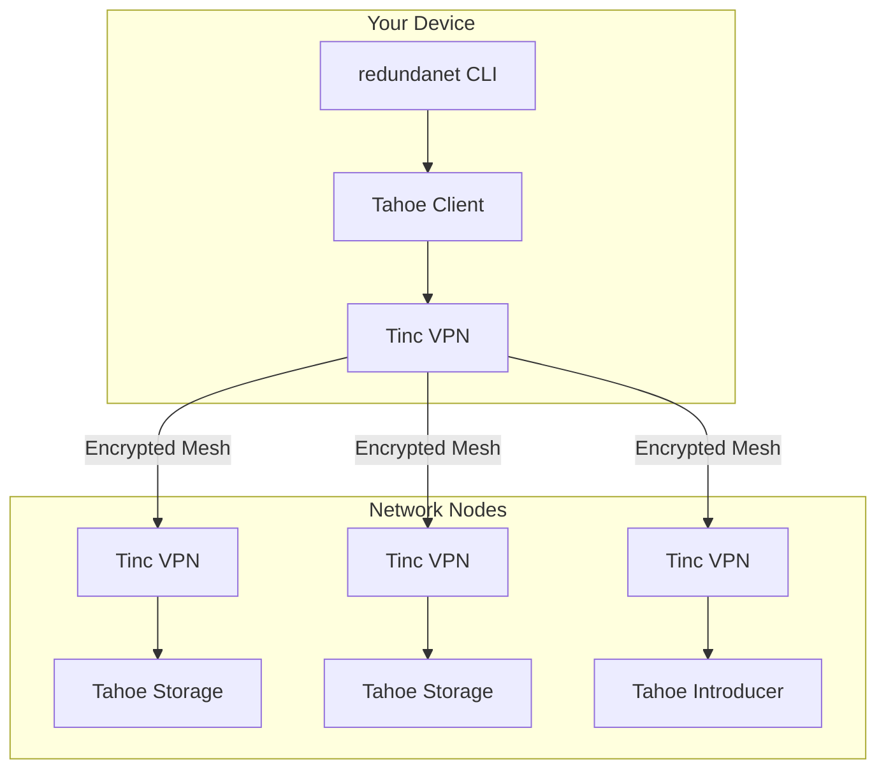

> This page describes RedundaNet 2, the legacy product, which stays live until the announced stop date. RedundaNet 3 is the current product: see [../README.md](../README.md).

This package, `redundanet` on PyPI, is the RedundaNet 2 command line tool; RedundaNet 3 is one binary from the GitHub releases, documented at <https://github.com/adefilippo83/redundanet/blob/main/docs/README.md>.

# RedundaNet - Distributed Encrypted Storage Network

[](https://github.com/adefilippo83/redundanet/actions/workflows/ci.yml)
[](https://pypi.org/project/redundanet/)
[](../../LICENSE)

RedundaNet is a distributed, encrypted storage system built on a secure mesh VPN network. It enables users to contribute storage resources to a collective grid while maintaining privacy through end-to-end encryption.

**Website**: [https://redundanet.com](https://redundanet.com)

## Features

- **Decentralized Architecture**: No central authority or single point of failure
- **End-to-End Encryption**: Data is encrypted before leaving your device using Tahoe-LAFS
- **GPG-Based Authentication**: Secure node identity verification via public keyservers
- **Private Networking**: Secure Tinc mesh VPN isolates the storage network
- **Erasure Coding**: Data is split and distributed across multiple nodes using a configurable *k*-of-*n* scheme (3-of-10 by default)
- **Open Membership**: Anyone can apply to join the network
- **Containerized Deployment**: Easy setup with Docker Compose
- **Raspberry Pi Ready**: Pre-built images for ARM devices

## How It Works

```
┌─────────────────────────────────────────────────────────────────────────┐
│                         RedundaNet Network                              │
│                                                                         │
│    Your File                                                            │
│        │                                                                │
│        ▼                                                                │
│   ┌─────────┐     Encrypted      ┌─────────┐                           │
│   │ Encrypt │ ──────────────────►│  Split  │                           │
│   │  (AES)  │                    │(Erasure)│                           │
│   └─────────┘                    └────┬────┘                           │
│                                       │                                 │
│              ┌────────────────────────┼────────────────────────┐       │
│              ▼            ▼           ▼           ▼            ▼       │
│         ┌───────┐    ┌───────┐   ┌───────┐   ┌───────┐    ┌───────┐   │
│         │Share 1│    │Share 2│   │Share 3│   │  ...  │    │Share10│   │
│         └───┬───┘    └───┬───┘   └───┬───┘   └───┬───┘    └───┬───┘   │
│             │            │           │           │            │        │
│             ▼            ▼           ▼           ▼            ▼        │
│         ┌───────┐    ┌───────┐   ┌───────┐   ┌───────┐    ┌───────┐   │
│         │Node A │    │Node B │   │Node C │   │Node D │    │Node E │   │
│         │ (VPN) │◄──►│ (VPN) │◄─►│ (VPN) │◄─►│ (VPN) │◄──►│ (VPN) │   │
│         └───────┘    └───────┘   └───────┘   └───────┘    └───────┘   │
│                                                                         │
│         Only 3 of 10 shares needed to reconstruct your file            │
└─────────────────────────────────────────────────────────────────────────┘
```

**Key Concepts:**
- **Your data is encrypted** on your device before upload - nodes cannot read your files
- **Erasure coding** splits data across nodes - with the default 3-of-10, any 3 of the 10 shares reconstruct your file
- **Mesh VPN** connects all nodes securely - no central server required
- **GPG keys** verify node identity - published to public keyservers

> **Encoding is configurable per network.** The *k*-of-*n* split (`shares_needed` / `shares_happy` / `shares_total`) is set in the network manifest; 3-of-10 above is the default example. A small network runs smaller parameters, and if `shares_happy` equals the number of storage nodes there is no write-redundancy headroom — losing any one node makes the grid read-only until another joins. Run `redundanet validate <manifest>` to surface this.

## Join the Network

Want to contribute storage and join RedundaNet? Here's how:

### 1. Generate and Publish Your GPG Key

```bash
# Install the CLI
pip install redundanet

# Generate a GPG key for your node
redundanet node keys generate --name my-node --email you@example.com

# Publish your key to public keyservers
redundanet node keys publish --key-id YOUR_KEY_ID
```

### 2. Submit Your Application

Visit [redundanet.com/join.html](https://redundanet.com/join.html) and fill out the application form with:
- Your GPG Key ID
- Storage contribution (how much space you'll share)
- Your region
- Device type

This creates a GitHub issue that's automatically processed.

### 3. Wait for Approval

A maintainer will review your application and merge the PR that adds your node to the network manifest.

### 4. Set Up Your Node

Once approved:

```bash
# Initialize your node (use the name assigned to you)
redundanet init --name node-XXXXXXXX

# Join the network: clones the manifest repo, installs the docker files and
# generates /opt/redundanet/.env from your manifest entry
redundanet network join --repo https://github.com/adefilippo83/redundanet.git --name node-XXXXXXXX

# Start services (storage node)
cd /opt/redundanet/docker
docker compose --env-file /opt/redundanet/.env --profile storage up -d

# Check status
redundanet status
```

## Quick Start (Existing Network Members)

### Prerequisites

- Python 3.11+
- Docker and Docker Compose
- GPG (for key management)

### Installation

```bash
pip install redundanet
```

### Start Services

Run from `/opt/redundanet/docker` (installed by `redundanet network join`,
which also generates the required env file):

```bash
# As a storage node (contributes storage)
docker compose --env-file /opt/redundanet/.env --profile storage up -d

# As a client only (uses storage)
docker compose --env-file /opt/redundanet/.env --profile client up -d
```

### Upload and Download Files

```bash
# Upload a file
redundanet storage upload /path/to/file.txt
# Returns: URI:CHK:abc123...

# Download a file
redundanet storage download URI:CHK:abc123... /path/to/output.txt
```

## CLI Commands

```
redundanet --help

Commands:
  init        Initialize a new node
  status      Show node and network status
  sync        Sync manifest from repository
  validate    Validate manifest file

  node        Node management commands
    list      List all nodes in the network
    info      Show detailed node information
    add       Add a new node to manifest
    remove    Remove a node from manifest
    keys      Manage GPG keys (generate, export, import, publish, fetch, list)

  network     Network management
    join      Join an existing network
    leave     Leave the network
    peers     Show connected peers
    vpn       VPN management (start/stop/status)

  storage     Storage management
    status    Show storage status
    upload    Upload a file
    download  Download a file
    mkdir     Create an aliased directory on the grid
    ls        List a directory capability or alias
    repair    Check/repair the redundancy of a capability
```

## Raspberry Pi

Pre-built RedundaNet 2 images were attached to releases up to v2.7.39; none
is built any more. Since 3.0.0 the Raspberry Pi image is RedundaNet 3's,
see [rpi-image/README.md](../../rpi-image/README.md). The old images worked
like this:

1. Download from [GitHub Releases](https://github.com/adefilippo83/redundanet/releases)
2. Flash to SD card using Raspberry Pi Imager
3. Boot and SSH in: `ssh redundanet@redundanet.local` (password: `redundanet`)
4. Run `redundanet init` to configure

## Architecture



**Components:**
- **Tinc VPN**: Creates encrypted mesh network between all nodes
- **Tahoe-LAFS**: Handles encryption, erasure coding, and distributed storage
- **GPG**: Authenticates node identity via public keyservers
- **Manifest**: YAML file in Git defining network configuration

## Documentation

- [Installation Guide](installation.md)
- [Quick Start Guide](quickstart.md)
- [Configuration Reference](configuration.md)
- [Quotas and allocation](quotas.md)
- [Joining RedundaNet 3 as an existing member](../migration.md)
- [Architecture Overview](architecture.md)
- [Design RFCs](../../rfcs/) (plans under discussion; `docs/` describes what runs today)

## Development

```bash
# Clone repository
git clone https://github.com/adefilippo83/redundanet.git
cd redundanet

# Install dependencies
make install

# Run tests
make test

# Run linting
make lint

# Run type checking
make type-check
```

### AI-assisted development

RedundaNet is designed and maintained by Alessandro De Filippo. Substantial
parts of the code are written with AI assistance (Claude); every change is
human-reviewed, gated by CI (lint, types, 250+ unit tests, end-to-end grid
tests), and proven on the live production network before release. Bugs, like
credit, land on the human.

Project instructions for AI coding tools live in [CLAUDE.md](../../CLAUDE.md).

## Contributing

1. Fork the repository
2. Create a feature branch (`git checkout -b feature/amazing-feature`)
3. Make your changes
4. Run tests (`make test`) and linting (`make lint`)
5. Commit your changes
6. Push to the branch (`git push origin feature/amazing-feature`)
7. Open a Pull Request

AI-assisted contributions are welcome under the same rule as everything else:
you review, test, and own what you submit.

## License

This project is licensed under the GNU General Public License v3.0 - see the [LICENSE](../../LICENSE) file for details.

## Privacy

RedundaNet collects nothing: no accounts, no analytics, no telemetry. What the software sends to hubs, storage servers and GitHub, and what stays on your device, is spelled out in [PRIVACY.md](../../PRIVACY.md).

## Code signing policy

Free code signing provided by [SignPath.io](https://about.signpath.io), certificate by [SignPath Foundation](https://signpath.org).

The Windows binary of a release is signed by SignPath Foundation after the maintainer approves the request. The signature says the binary was built by the release workflow of this repository, from the tagged source, on GitHub's runners, and has not changed since; the certificate names SignPath Foundation as the publisher, not RedundaNet. The macOS binaries are signed with the maintainer's Apple Developer ID and notarized by Apple. Linux binaries carry no signature of their own. On every platform the agent installs only what the [release index](../../releases/README.md) names, after verifying the maintainer's signature on the index, so a self-update never rests on the platform's signing alone. Each release page states whether its binaries are signed.

Team:

- Authors, who commit without a further review: Alessandro De Filippo ([@adefilippo83](https://github.com/adefilippo83)).
- Reviewers, who review every change proposed by anyone else before it is merged: the same.
- Approvers, who approve each signing request: the same.

Team members use two-factor authentication on GitHub and SignPath. Every change, AI-assisted ones included, is reviewed by the maintainer before it reaches `main`, and releases are built only from tags on `main`.

Privacy: RedundaNet collects nothing; see [PRIVACY.md](../../PRIVACY.md). The agent installs a service only when asked (launchd on macOS, systemd on Linux, a scheduled task at logon on Windows) and says what it did; `redundanet service uninstall` removes it.

## Acknowledgments

- [Tahoe-LAFS](https://tahoe-lafs.org/) - Distributed storage system
- [Tinc VPN](https://www.tinc-vpn.org/) - Mesh VPN daemon
- [Typer](https://typer.tiangolo.com/) - CLI framework
