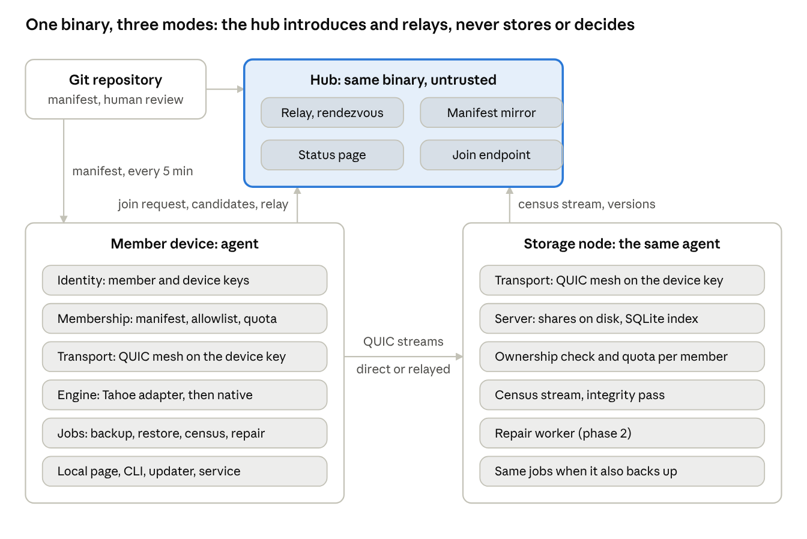
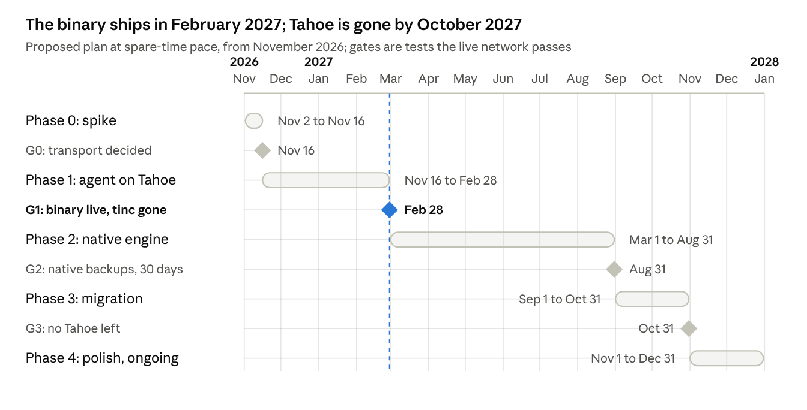

# RFC 0001: RedundaNet 3

One binary on Windows, macOS and Linux, with a native storage engine.

- Status: Draft
- Date: 2026-10-23, revised 2026-10-26
- Author: Alessandro De Filippo
- Discussion: https://github.com/adefilippo83/redundanet/discussions/132
- Review: [0001-review-2026-10-25.md](0001-review-2026-10-25.md)

---

## Changes in revision 2

Revision 2 answers the hostile review of 2026-10-25, which confirmed 80
findings: 5 blockers, 47 major, 28 minor. Finding ids below are the review's.
Where the review offered alternatives, the choice taken is named so it can be
overturned in the discussion.

| Area | Findings | What changed | Choices taken |
| --- | --- | --- | --- |
| Keys and deletion | F01, F02, F09, F43 | The member key is never stored on a device; devices sign roots, descriptors and delete tokens; revocation records and their path to servers; one deletion invariant with server clocks and pending sets; two-phase deletion with a 30-day tombstone | Certifying and revoking need the phrase in hand; servers keep 10 previous root versions |
| Root quorum | F03 | PutRoot confirmed by a majority of storage servers; cleanup refused below a guaranteed overlap; restore reports how many servers answered | |
| Manifest absence | F04, F13 | Servers never delete on absence; grace measured on each server's clock; `leaving_since`, one state table, immutable member keys | |
| Legacy backups | F05 | Step 3 imports the Tahoe client's aliases as legacy roots before the compose stack goes | |
| Trust roots | F06, F07 | One offline operator key signs the manifest from phase 1; the hub mirror serves only signed objects; the release key rotates only through its own chain; a stolen-operator-key row | Signing in phase 1 rather than dropping the mirror; 90-day signature age |
| Object identity | F17, F18, F19, G09, G14 | Encoding in the convergent key; canonical descriptor; partial and complete shares; one read per upload; cache rows carry engine and encoding; census carries k and n | Files uploaded before an encoding change no longer dedup against new uploads |
| Quotas | F16, F20, G20, G21, G23 | Servers bound an owner at `quota_headroom` times a size-proportional share and the client holds the exact budget, said plainly; accounted size and an object ceiling; reserve sized to the largest server; declared contribution as the input | 4 KiB minimum per share; 1,000 objects per GB; validate warns rather than refuses on the reserve |
| Repair | F15, F21, G19, G22, G24, G26, G27 | Non-owner writes only with a hub-signed repair task; down versus dead; a quiescence window; one scheduler; surplus released only after the holder checks; tombstones outlive purge; small networks; two bandwidth classes; encoding transitions accounted at zero | 72 hours to dead; 24 hours of quiescence; a quarter of the cap for service traffic |
| Membership | F11, F12, F14, F40, G05 | Signed invites in a link that carries the network descriptor; the hub opens issues only and the repository's workflow makes the pull request; storage devices are manifest entries; sponsor and `legacy_pgp` records; what a fork needs | Invites expire in 7 days and serve one request |
| Restore from the phrase | F22, F23, F24, G03 | The agent keeps the root registry from phase 1; migrated devices keep their Tahoe convergence secret; F16 split into an unattended restore test and a member-started phrase check; the phrase only on the device or through SSH | Agent registry rather than deterministic Tahoe keys |
| Backup job | F33, F44, F56, G10, G11, G12, G13, G15, G16, G17 | Change time and file ids; per-file failures; a file-kinds table; names as bytes; a clocks paragraph; partial snapshots every run; safe restore writes; `Has` in the engine interface | Cloud placeholders skipped by default; hardlinks restored as copies; 1% rolling re-hash |
| Migration | F08, F25, F26, F27, F28, F29, F38, F39, F52, F53 | Step 0 for hubs, a transitional manifest and identities; the sidecar's update path and healthcheck; `redundanet migrate-node` with rollback; G1 split into G1a and G1b; a straggler rule; targets with their hours-per-week basis; a pinned Tahoe requirements file | 120 days to retire Tahoe after G2, one 60-day extension; about 15 hours a week |
| Transport and platforms | F10, F30, F31, F32, F34, F35, F36, F37, F58, G01, G02 | Path switching priced as owned code and the requirement relaxed to a resume within seconds; a TCP 443 relay fallback and IPv6; wire identity; the cipher chosen at G0; storage availability; the Tahoe bundle; two-stage self-update; one administrator step for unattended storage on macOS and Windows; no LAN binding and browser guards on the local page | Relaxed switching requirement; LAN binding dropped |
| Community rules | F42 | A `COMMUNITY.md` template states the rules that rest on trust | 90 days of silence before a member is marked leaving |

Not addressed in this revision, all minor: F41 (risk table and packaging
disagree on signing), F48 (STUN candidates only), F50 (bridge port model),
F51 (phase 1 introducer plumbing), F54 (two grids on one disk), F55 (logs only
in memory), F57 (iroh's maturity is out of date), F59 (the MinIO row), F60
(the restic credit), G04 (the public page's projection), G06 (the diagnostics
bundle) and G25 (which k shares a restore uses). The roadmap image still shows
a single G1.

---

## Part 1: Product requirements

### Summary

RedundaNet 3 is one binary that turns a group of people who trust each other
into a backup service for each other, on Windows, macOS and Linux, with no root
and no Docker. A member installs it, keeps a disk online, and gets space on
everyone else's disks in proportion to what they contribute. Files are
encrypted on the member's own machine and spread with erasure coding, so no
single node, and no single member, can read or lose anyone's data.

What stays from RedundaNet 2: the social contract (membership is a pull request
reviewed by people), the Git manifest as the source of truth, client-side
encryption, k-of-n erasure coding, the hub as a dumb relay plus a public status
page, and the GPL-3 licence that lets any community fork the repository and run
its own network.

What changes: Docker and tinc go away, replaced by an in-process userspace mesh
that needs no privileges; the Python runtime and the gpg binary go away,
replaced by a single static executable with its own keys; and, in a second
step, Tahoe-LAFS is replaced by a native storage engine that knows who owns
each share, so usage is measured by servers instead of self-reported and
quotas are bounded by servers instead of trusted, repair works without the
owner, and there is no lease crawler to break.

The promise in one line: a storage community you join with a pull request, run
from one binary, that no company can take away.

### Problem

RedundaNet 2 works, with 10 nodes, 6 members, 263k objects and no file lost in
19 months, but it only works for people who already run Linux servers. Every
pain point below has been hit on the live network, not imagined.

**For a member**

- Linux only, root required, Docker required. The three candidates who would
  have joined from a Mac or a Windows PC could not.
- Joining takes a GPG key on a keyserver, a form, an issue, a bot PR and a
  merge, then a CLI with four commands. The identity step alone loses most
  non-technical people.
- Backup is a Samba share plus a sidecar on the node. A laptop user has nothing
  to point at a folder.
- Restore on a new machine depends on a capability string the member has to
  keep somewhere. Nobody has tested a restore from scratch.

**For the operator**

- Every outage of the last year came from the plumbing, not the storage: the
  tinc network namespace trap, the compose override silently dropped, the disk
  that mounted empty, Compose v1 on a new OS.
- Tahoe-LAFS upstream is dormant since December 2024. Its SFTP frontend never
  closes sessions, its lease crawler crashed on every restart and nobody
  collected garbage from September to October 2026, its dependencies are
  pinned by hand after a pyOpenSSL release broke every container.
- Quotas are on trust because the storage server does not know whose share it
  holds. A usage report 11 days old is the normal state of one member today.
- Repair needs the owner's client. If a member is away for months, nobody can
  repair their objects.
- The hub is a rendezvous that must see real IP addresses, which a proxied host
  cannot do, so the network needs two hubs of two different kinds.

**For a community that wants its own network**

- The quickstart says fork the repo and edit the manifest, and that is true,
  but the result is a Linux fleet with a Docker stack to operate, not something
  a club hands to its members.

The common cause is that RedundaNet 2 is a deployment of three excellent but
unrelated programs (Tahoe, tinc, Docker) glued by Python. The glue is where the
failures live, and the glue is what forbids other platforms.

### Goals and non-goals

**Goals**

1. One binary per platform (Windows x64, macOS arm64 and x64, Linux x64 and
   arm64) that installs without administrator rights and runs as a user
   service. A storage node on macOS or Windows that must keep running with
   nobody logged in takes one administrator step, and only that.
2. A member joins with the app: generate a key, write down a recovery phrase,
   submit a request, wait for a human to approve. No GPG, no CLI, no Git
   knowledge.
3. Back up folders from any device, restore them on any device with the
   recovery phrase and nothing else.
4. Contribute a disk and receive an allocation in proportion, measured and
   bounded by the storage servers, not by trust.
5. Durability that is measured and repaired by the network itself, including
   for members who are offline for months.
6. Keep the trust model: client-side encryption, hosts see only ciphertext,
   membership decided by people, identity owned by the member, no central
   server that can read, admit or expel on its own.
7. Keep the fork story and make it real: a community starts its own network
   with one manifest and one hub, documented end to end.
8. Migrate the live network without a flag day and without losing a file.

**Non-goals, for this version**

- Public or anonymous networks. Members are people vetted by people; the design
  assumes it.
- Mobile apps. A phone backs up through a desktop or a NAS node, if at all.
- Real-time sync between devices, shared folders, or multi-writer
  collaboration. This is backup, one writer per root.
- A hosted service, billing, or any revenue path. Communities fund their own
  hubs, as today.
- Reading RedundaNet 2 share files with the new engine. Migration is by
  re-upload (see Migration plan).
- A native GUI toolkit. The first interface is a local web page served by the
  agent; a tray application comes later if members ask for it.
- The SFTP frontend and the FUSE mount of RedundaNet 2. They retire when a
  node leaves its compose stack; restore and the local page replace them, and
  a configured `SYNC_DIR` becomes a backup set.

### Users and jobs to be done

Three kinds of people use the product, and they want different things from it.

| User | Who they are today | What they need to do | What success looks like |
| --- | --- | --- | --- |
| Member | Six people in the live network, mostly technical; the next ones are friends of members on Mac or Windows | Join, keep a node online, back up folders, restore on a new machine, see that their data is safe | Joined in a day, a first restorable snapshot after the first evening, a restore test that works, never thinks about it again |
| Community operator | The maintainer, and the one or two people who review join requests | Run the hub, approve and remove members, watch the status page, roll out updates, handle the member whose node is misbehaving | An update that cannot strand a node, a page that tells the truth, a member removal that is one merge |
| Forker | A LUG, a cooperative, an office, a large family | Start a network of their own with their own rules and keep it running without the original maintainer | A manifest, a hub and a first member in one afternoon, following one guide |

The member is the one the binary is for. The operator and the forker are served
by the same binary in hub mode plus the repository as a template.

A member has two kinds of devices: a storage node that stays on (a Raspberry
Pi, a NAS, an old PC) and client devices that come and go (a laptop). The
product must treat both as the same member, and a member with only a laptop
must still be able to join as a client without contributing disk, at the
allocation their community decides.

### Principles

The six principles of RedundaNet 2 stay, worded as tests a design must pass.
Three are added by the move to a product.

1. **Nobody can read your data.** Encryption happens on the member's device; a
   storage host, a relay, the hub and the maintainer see ciphertext and opaque
   identifiers. Test: a complete copy of every server disk plus the hub reveals
   no file name and no content.
2. **Any node can die.** Erasure coding with k-of-n chosen by the community;
   the network repairs itself. Test: with n minus k servers down, every object
   is readable; when they come back or are replaced, the network returns to
   full placement without human action.
3. **No central authority.** Identity is a key the member generates;
   membership is a file in Git that people review; the hub cannot admit, expel
   or impersonate anyone. Test: a hub fully compromised can delay traffic and
   lie on a web page, nothing else. Phase 1 falls short of the test in one way
   the threat table states: the hub hosts the Tahoe introducer, so it can write
   shares like any device until the native engine verifies ownership.
4. **Any hardware, behind NAT.** Home routers, no port forwarding, slow
   uplinks. Test: two members both behind NAT exchange data; a relay carries it
   when hole punching fails.
5. **Verified members, not anonymous.** People approved by people, and the
   rules that rest on that trust are stated. Test: the manifest says who
   vouched for whom, and each vouch is a signature anyone can verify.
6. **Boring operations.** One binary, a service that restarts itself, an update
   that rolls back on failure, a status page that tells the truth. Test: an
   operator can leave for a month.
7. **No privileges.** (new) Install and run as an ordinary user: the client
   role on every platform, and storage on Linux. Unattended storage on macOS
   and Windows takes one administrator step, because those systems run nothing
   for a user who is not logged in. Nothing in the design needs a kernel
   driver or a TUN device.
8. **Fairness is enforced, not assumed.** (new) Servers know whose bytes they
   hold and refuse writes past a bound of twice a member's budget by default;
   the member's own client stops at the budget itself; the usage on the status
   page comes from servers, not from self-reports, so a member over budget is
   visible to everyone. Test: a member who removes the client check from their
   build is refused at the bound and shown over budget on the page.
9. **Your community, your network.** (new) Nothing in the code points to the
   original network; a fork edits one file, signs it with its own operator key
   and runs its own hub. On an unmodified binary a fork takes its updates from
   the original release chain, which can ship code but never change the fork's
   membership. Test: a second network has run for a month on an unmodified
   binary.

### Functional requirements

Numbered so the design and the milestones can refer to them. "Must" is phase 1
or 2 scope; "later" is after the native engine ships.

**Identity and membership**

- F1. The app generates the member's key on first run and shows a recovery
  phrase once; the phrase alone restores identity and data on another device.
  Must.
- F2. A member can authorize additional client devices without a change to
  the manifest. A storage device is a manifest entry, so adding or replacing
  one is a one-line request the app submits. Must.
- F3. Joining is a request the app submits (name, member key, contribution,
  first storage device if any, and an invite signed by an active member) that
  lands as a reviewable change to the manifest; a human merges it. Must.
- F4. Leaving, or removal by operators, is a manifest change; the member's
  shares are deleted after a grace period the community sets. Must.
- F5. Every node verifies the manifest's origin before applying it; a
  compromised hosting account cannot add a node silently. Must (one operator
  key from phase 1, a threshold later).

**Network**

- F6. Nodes reach each other without open ports, with direct paths when NAT
  allows and a relay otherwise; no privileges required. Must.
- F7. Only nodes listed in the manifest, or certified by a listed member, can
  connect. Must.
- F8. Bandwidth limits per node, upload and download, with a schedule, so a
  backup never saturates a home uplink. Must.

**Storage**

- F9. A storage node contributes a directory on a disk of the member's choice;
  the app refuses to run storage on the wrong disk, and a disk that disappears
  while running is reported, never replaced by the system disk (the October
  2026 incident must be impossible). Must.
- F10. Allocation per member = contribution × k/n minus the community reserve,
  computed from the manifest; the client stops at it, servers refuse writes
  past `quota_headroom` times it, and the status page shows usage as servers
  count it. Must (bounded by servers in phase 2, computed and client-enforced
  in phase 1).
- F11. Placement puts the n shares of an object on n distinct servers, and on
  distinct members where possible. Must.
- F12. Every object is checkable and repairable from k shares by any node,
  without the owner's keys. Phase 2.

**Backup and restore**

- F13. A member picks folders; the app backs them up on a schedule,
  incrementally, deduplicated within the member's own data, with snapshots.
  Must.
- F14. Snapshots are retained by a policy the member sets (for example daily
  for 30 days, monthly for a year); pruned objects are deleted from the grid.
  Must.
- F15. Restore any snapshot, whole or by folder, on any device of the member,
  from the recovery phrase alone. Must.
- F16. Two checks, kept apart on purpose. F16a: a sample restore the app runs
  on its own every month from the device's stored keys, on any device that
  backs up, headless ones included, reported to the status page. F16b: "check
  my recovery phrase", an action the member starts on the device itself, which
  proves the paper copy without restoring anything; the app suggests it at
  most once a quarter and never schedules it. Must.
- F17. Excludes by pattern; large files resumable across restarts; moved and
  renamed files not re-uploaded. Must.

**Health and operations**

- F18. Each node reports liveness, free space, and a census of what it holds;
  the hub aggregates them into a public status page with per-object placement
  counts. Must.
- F19. The network repairs under-placed objects without human action, and
  rebalances after a k-of-n change on the owners' own devices, without anyone
  else's action; the status page shows progress. Phase 2 for repair without
  the owner.
- F20. Self-update from signed releases, with a health check and automatic
  rollback to the previous binary; the manifest can require a minimum version.
  Must.
- F21. A local page on each node shows status, backups, restores, logs and
  settings; the CLI drives the same API. Must.
- F22. The hub mode runs in the same binary: relay, manifest mirror, status
  page, join endpoint. Must.

**Fork kit**

- F23. One guide takes a new community from an empty repository to a running
  hub and a first member. The binary carries no reference to the original
  network: which network an app joins comes from the network descriptor in the
  invite. The guide states what a fork needs: a GitHub repository with
  Actions, a VPS for the hub, an operator key, and either the original release
  chain or its own release key and build. Must.

### Non-functional requirements

The numbers come from the live network: a Raspberry Pi 4 with a USB disk, a
2 GB virtual machine, an uplink of 0.5 Mbit/s at one member, 263k objects today
and a million as the design point.

| Area | Requirement |
| --- | --- |
| Platforms | Windows 10+ x64; macOS 12+ on arm64 and x64; Linux glibc x64 and arm64 (Raspberry Pi 4 and 5, 64-bit OS). One static binary per target, no runtime to install |
| Privileges | Install, run and update as an ordinary user. No kernel driver, no TUN device. A per-user service that starts at login, and at boot on Linux with lingering; on macOS and Windows a storage node that must run with nobody logged in takes one administrator step (see Service integration) |
| Footprint | Agent idle under 100 MB RSS and under 1% CPU on a Pi 4; a storage node with 1M shares indexes them in SQLite and answers a census query in under 2 s without walking the disk |
| Throughput | Upload and download bounded by the member's uplink, not by the app: erasure coding and encryption above 300 MB/s on a laptop, above 80 MB/s on a Pi 4 using its four cores; a relayed path above 50 Mbit/s on the hub's side |
| Transfers | Every upload and download resumable at segment granularity across restarts and network changes; backoff on a dead peer; a switch between relay and direct path resumes the transfer within seconds |
| Durability | With k-of-n = 2-of-4 and placement on distinct members, any two servers lost at once lose nothing; repair starts within one hour of a server being declared dead and completes at the speed of the slowest surviving uplink, provided the reserve covers the lost server; when it does not, the page shows the shortfall |
| Consistency | A member's root advances only by its own signed versions; two devices of one member never overwrite each other's snapshots (one root per device) |
| Availability | Reads need k servers up; writes need n distinct servers up, or the write is marked under-placed and repaired later; the hub down means no new connections for peers without a cached direct path, nothing else |
| Security | Ed25519 identities, authenticated encrypted transport, per-object keys, authenticated encryption on every segment, signed share ownership, signed releases verified before install |
| Privacy | Servers learn storage indices, sizes, owner identities and timing; never file names, counts of files per folder, or content. The hub learns liveness and census summaries |
| Compatibility | The manifest schema is versioned; an agent refuses a manifest newer than it understands and updates itself; the share format on disk is versioned from day one |
| Observability | Structured logs with a ring buffer visible in the local page; a status endpoint per node; the hub's status page and its join endpoint are the only public surfaces |
| Supportability | One command (or button) produces a diagnostic bundle: versions, manifest revision, peers reachable, last errors, disk check. No secrets in it |

### User journeys

Each journey is written as the member would tell it. The design sections say
how each step works.

**First run.** I download the app for my machine and open it. It asks for a
name and shows me twelve words to write down, and makes me type three of them
back. It asks whether this machine contributes disk; I pick a folder on my
external drive and a size. I open the invite link a friend sent me; the app
shows the network's name, my friend's name, and a ten-group code that I read
to my friend over the phone. I send the request. The app says "waiting for
approval" and shows me the page where that happens.

**Approval.** My friend's app asks them to confirm my request and to check the
code I read them. The operator sees a pull request with my name, my key, my
contribution, my friend's signed invite and their confirmation, all verified by
CI. They merge and sign, and within five minutes my app says "connected, 7
peers". I never saw Git.

**Backup.** I pick three folders and a schedule. The first backup runs for two
days on my uplink at the limit I set; the page shows progress, what is waiting,
and that each file is on four servers. From then on it runs every 15 minutes
and uploads what changed.

**Restore on a new laptop.** The old laptop is gone. I install the app, choose
"I already have a recovery phrase", type the twelve words. It finds my roots on
the network and lists my devices and snapshots. I pick last Tuesday and a
folder, and get it back, with the hashes verified.

**My node dies.** My Pi's disk fails. The status page shows my node down and my
member's objects still readable; once it has been silent for three days, the
network's default repair window, it starts repairing the shares that lived on
my disk onto other servers. I replace the disk, the app
sees an empty folder with no marker, asks me to confirm it is a new disk, and
rejoins. Nobody else did anything. Had I reinstalled the Pi from scratch, the
app would ask for my phrase, certify the new device and send a one-line
request that swaps the device key in my storage entry; the node stores nothing
until that change is merged and signed.

**I leave.** I ask the operator to remove me, or I open the request from the
app. After the merge my shares are deleted everywhere after the grace period,
my allocation goes back to the pool, and my devices are refused at the door.

**Update.** A new release appears. Each node downloads it, checks the
signature, starts it on probation, and keeps it only if it reaches the same
peers and serves its page. One node's new version fails the check and is
dropped while the old one keeps running; its owner gets a line in the local
page, the operator sees it on the status page.

**I start my own community.** I fork the repository, write a manifest with my
name as first member and my VPS as hub, create my operator key and sign the
manifest, run the hub mode there, and generate a network descriptor. I join
from my own machine with it and send the next person an invite link. My
members take updates from the original release chain unless I build and sign
my own binary. The guide took an afternoon.

### Success metrics

Measured on the live network, read off the status page or the release
pipeline, not estimated.

| Metric | Today (RedundaNet 2) | Target after phase 1 | Target after phase 2 |
| --- | --- | --- | --- |
| Time from download to "connected" for a new member, excluding the human approval | Hours, Linux only | Under 30 minutes on any platform | Under 15 minutes |
| Members on macOS or Windows | 0 of 6 | 2 | Half of new members |
| Sample restores per member, run unattended by the app (F16a) | 0 | 1 per month | 1 per month |
| Members who checked their recovery phrase in the last year (F16b) | 0 | Shown on the page | Over half |
| Usage figures older than 24 h on the status page | 1 member of 6 | 0 (still self-reported) | 0 (server-reported) |
| Objects under-placed for more than 7 days | 12k of 263k | Under 1% | Under 0.1%, repaired without owners |
| Plumbing incidents per quarter (network namespace, mounts, compose, packaging) | 4 in the last two quarters | 1 | 0 |
| Nodes stranded by an update | 0, thanks to rollback | 0 | 0 |
| Communities running their own network on the binary | 0 | The guide run end to end on a test network | 1 trial community |
| Agent memory on a Pi 4 at 250k shares | 440 MB (Tahoe plus sidecars) | Under 300 MB | Under 100 MB |

The under-placement row counts objects past the quiescence and repair windows
under Health. After a large server dies, repair moves its data at the service
rate the survivors' uplinks allow, which for a 1 TB node on home connections is
weeks, not days; the page then shows an expected completion date, and meeting
that date is the measure.

### Phases

The binary ships before the engine, so the community gains something within
months and the engine never blocks it. Each phase ends with the live network
running on it. The drawn roadmap with gates is under Spike plan and
milestones.

**Phase 0, spike (2 weeks).** Decide the transport and the language with a
prototype: two Tahoe nodes on two laptops, one behind NAT, talking through the
new mesh and the loopback bridge; measure throughput against tinc and
reconnection after a network drop. Exit: a written decision with numbers.

**Phase 1, the agent on Tahoe (3 months).** One binary with identity, signed
manifest sync, mesh, loopback bridge, Tahoe as a bundled child process, the
root registry, census, usage
meter, lease sweep, backup of folders, local page, user service, self-update,
hub mode with relay. Ships as a sidecar container on existing Docker nodes
first, then as the native install for new members. Exit: G1a, a macOS or
Windows member in the live network. G1b, tinc removed from every node, follows
at members' pace and is not on phase 2's critical path.

**Phase 2, the native engine (4 to 6 months).** Objects, encryption, erasure
coding, ownership, server-side quota bounds, roots and snapshots, repair without the
owner, deletion without leases, census from the server index. Runs as a second
grid on the same agents while Tahoe keeps serving the old one. Exit: the
maintainer's own backups run on it for a month with weekly restore tests.

**Phase 3, migration (1 to 2 months).** Members re-upload into the new grid at
their own pace; the status page shows both; Tahoe is switched off per node when
its member has moved, then removed from the binary. Exit: no Tahoe process on
the network.

**Phase 4, product polish (ongoing).** Tray application, threshold signing of
the manifest, device management, restore test reports, the fork guide validated by a second
community.

Calendar time for one person at about 15 hours a week is about a year to the
end of phase 3; the gates and what shortens them are under Spike plan and
milestones. Nothing in phase 2 is on the critical path of phase 1.

### Risks

| Risk | Likelihood | Impact | Mitigation |
| --- | --- | --- | --- |
| The rewrite takes two years and the live network gets nothing meanwhile | High if the engine comes first | Community loses interest | Phase order: the binary ships on Tahoe first; the engine is behind an interface and never on the critical path |
| The transport library churns or dies (iroh is young; libp2p is heavy) | Medium | Rework of one layer | Transport behind an interface with a loopback-bridge fallback; the spike picks with numbers, not opinions |
| A bug in the native engine loses data | Low with care, catastrophic | Trust gone | Tahoe keeps the old grid until phase 3; integrity trees on every segment; a restore test is a product feature; the maintainer's own backups go first |
| A deletion path removes live data: a race between a member's devices, a stale root view, a manifest slip, a migration step | Medium without the rules under Deletion, catastrophic | Trust gone | One invariant for deletion; server-side clocks and pending sets; root quorums; two-phase deletion with a 30-day tombstone; never delete on manifest absence; legacy roots imported before a compose stack goes |
| Server-side quotas are gamed by a member with many devices | Low (vetted members) | Unfairness | Quotas are per member, devices are certified by the member key; servers refuse past `quota_headroom` times the budget; the status page shows per-member usage from servers |
| Windows: antivirus flags the binary, service install needs admin, paths and locks differ | Medium | Support load | Signed releases (Authenticode) from the start; scheduled task at logon instead of a service; CI runs the test suite on Windows |
| A backup looks complete when it is not: macOS privacy grants missing, Desktop and Documents held as cloud placeholders by OneDrive or iCloud | High on default Mac and Windows installs | Members lose files they believed backed up | Per-folder access probe in the wizard; permission skips mark the run incomplete; placeholders skipped and counted with a per-set opt-in; a stable Developer ID so macOS grants survive updates |
| Relay cost grows with members behind symmetric NAT | Medium | Hub bandwidth bill | Direct paths preferred; relay metered on the status page; a community can add relays as it adds hubs today |
| Loss of the recovery phrase loses everything | Certain for some members | Their data | The phrase is shown once and verified by typing it back; the app nags until a restore test passes; no escrow, by principle |
| One maintainer | Certain | Bus factor | Written design (this document), CI that gates releases, the fork kit so a community can carry on with the code |
| Tahoe dormant until phase 3 | Certain | Known bugs stay | Already lived with; the base-image patch and pins stay until Tahoe is removed |

### Open questions

Decisions the maintainer or the community must make; each has a recommended
answer in the Design part.

- [ ] Go or Rust (Design: Language and library choices recommends Go).
- [ ] Transport: iroh, libp2p, or tsnet with a self-hosted Headscale
      (recommends iroh if Rust, pion plus a self-hosted relay if Go; the spike
      decides).
- [x] PGP keys: kept only as an optional `legacy_pgp` record for continuity
      with RedundaNet 2; the vouch is the signed invite. Revision 2 decided.
- [ ] Grace period before a removed member's shares are deleted (recommends
      30 days).
- [ ] Default k-of-n for new networks (recommends 2-of-4 until a network has
      8 storage nodes, then 3-of-6).
- [x] Join path: the hub verifies the invite and opens an issue with an
      issues-only token; the repository's workflow makes the pull request, so
      the app never needs a GitHub token and the hub cannot push. Revision 2
      decided.
- [ ] Manifest signing threshold: one operator key from phase 1 is decided;
      when to require two of three (recommends as soon as a network has three
      operators, since a single stolen operator key has no clean recovery).
- [ ] Segment size (recommends 1 MiB; small files are one segment).
- [ ] Should client-only members get an allocation, and how much (community
      rule, recorded in the manifest).
- [ ] Name and versioning: RedundaNet 3.0 as a new major, or a new name for the
      binary.

---

## Part 2: Design

### Architecture overview

One binary, `redundanet`, runs in three modes: **agent** on every member
device (client role, storage role, or both), **hub** on a server (relay,
manifest mirror, status page, join endpoint), and **CLI**, which only talks to
the local agent's API. Everything a node does happens inside the one agent
process; there are no containers, no sidecars and no external daemons.



Devices exchange data directly over QUIC and go through the hub's relay only
when NAT forbids a direct path; the manifest in Git is what admits a device,
and the hub never holds a key or a share.

The agent is six components behind interfaces, so that each can be replaced
without touching the others:

1. **Identity**: the member key, the device key and the certificate that binds
   them (see Identity and keys).
2. **Membership**: fetches the manifest, verifies it, derives the peer
   allowlist, the allocation table and the network parameters (see
   Membership).
3. **Transport**: a userspace mesh endpoint identified by the device key;
   direct paths through NAT when possible, the hub's relay otherwise;
   authenticated streams to any allowed peer, and nothing to anyone else (see
   Transport).
4. **Storage engine**: in phase 1 an adapter that runs Tahoe as a child process
   and bridges it onto the mesh through loopback ports; in phase 2 the native
   engine, a client library and a server that speak over mesh streams (see
   Storage engine interface, Native engine).
5. **Jobs**: backup, census, check and repair, rebalance, deletion, restore
   test, each a scheduled task with a budget and a resumable state in SQLite
   (see Backup and restore, Health).
6. **Surface**: the local HTTP API with its web page, the updater and the
   service integration (see Local API, Service integration).

The hub reuses the same components: transport in relay mode, membership as the
directory that serves the manifest to agents, a status collector that is
today's monitor code fed by census streams, and a join endpoint that turns an
app request into a pull request.

The data path for a backup is: scan folders, split files into segments,
encrypt each segment with a per-object key, erasure-code it into n shares, send
each share to a distinct server over a mesh stream signed by the device, write
the snapshot as an object of the same kind, then publish a signed root record
that names the new snapshot. Reading is the reverse from any k shares. Servers
never see a key, a name or a plaintext byte.

### Identity and keys

A member is a 128-bit seed, shown once as a 12-word recovery phrase.
Everything else is derived from it or certified by it, so the phrase alone
restores a member on a new device, and nothing but the phrase can.

| Key | Derived how | Used for | Lives where |
| --- | --- | --- | --- |
| Member signing key (Ed25519) | HKDF(seed, "sign") | Member-level acts only: signs the join request, certifies devices, revokes devices | Nowhere at rest: derived from the phrase when one of those acts needs it, then erased from memory |
| Member secret (32 bytes) | HKDF(seed, "secret") | Derives the convergence secret (dedup only within the member's own data) and the key that encrypts root records. In phase 1, a device migrated from a compose stack keeps its Tahoe client's own convergence secret for its backups (see the Tahoe adapter) | Every device of the member, encrypted at rest |
| Device key (Ed25519) | Random per device | Transport identity on the mesh; signs every storage request, the device's own root record, the descriptors it uploads and the delete tokens it issues | That device only |
| Device certificate | Signed by the member signing key over (network name, device public key, member public key, roles, issued at, serial) | Proves to servers and peers that a device acts for a listed member | Presented on connect; stored by servers beside every descriptor and root it vouches for |

The split is the point of the table. Everything a device does every day is
signed by its own key, so taking a device gives an attacker that device and
nothing it cannot be stripped of: it cannot certify a new device, revoke the
real ones, or write another device's root. The price is that certifying and
revoking need the phrase in hand, which is the right friction for the two acts
that change who the member is.

The manifest lists members by their signing public key. Servers accept a
request when the device certificate chains to a listed member and the member
is active; they never need to know a device in advance, which is what makes
adding a laptop a local act (F2) and not a pull request.

**Adding a device.** Phase 1: type the phrase on the new device; it derives
the member signing key, certifies its own device key, stores the member secret
and erases the rest. Later: pairing, where the new device shows a code and an
existing device, after the member types the phrase there, sends the
certificate over an authenticated mesh stream, so the seed never travels.

**Losing a device.** The member types the phrase on any device and revokes the
lost one. The revocation record is `{network, member, device key, serial,
revoked_at}` signed by the member signing key. The agent sends it directly to
every live storage server and to each hub; servers store it, refuse the device
from then on, and include their revocation list in the census, so a server
that was offline learns it from the hub or from any peer on its next sync, and
the hub serves the full list to every agent with the manifest. Signatures a
server accepted before `revoked_at` stay valid, so the descriptors and roots
the device wrote while it was trusted keep verifying and repair keeps working.

What the holder of a lost device can still do is bounded and visible: read
what that member's devices can read, because the device holds the member
secret; and, until revocation lands, write and delete as that device. Deletion
is two-phase (see Health), so anything it deletes stays recoverable for 30
days from any other device of the member, and it can never overwrite another
device's root. In phase 1 the Tahoe adapter cannot give these guarantees for
data on the old grid: a device holding Tahoe write capabilities can overwrite
the mutable directories it holds, as it can today, and expiry rather than a
delete token is what removes data there.

**Losing the phrase.** The data is unreadable to everyone, by principle; there
is no escrow. The app verifies the phrase by asking for three words at first
run. "Check my recovery phrase" (F16b) proves the paper copy later: the member
types the words, the app derives the member key and the member secret, checks
that they match the member's listed key and open the member's root records,
and erases them. The scheduled restore test (F16a) never asks for the phrase,
because a test that prompts every month trains members to type their phrase
into whatever asks for it.

**Where the phrase may appear.** The phrase is the one secret with no
revocation, so the app shows it or accepts it only on the device itself: in the
local page, which is served on `127.0.0.1` only, or in the CLI; on a headless
node both are reached through SSH, never in cleartext over the LAN. First run,
adding a device, revoking one and the phrase check all follow that rule.

**Key storage at rest.** The device key and the member secret sit in a file
readable only by the user, encrypted with a key held in the OS keystore where
one exists (Keychain on macOS, DPAPI on Windows, the secret service on desktop
Linux) and otherwise with an optional passphrase. A headless Pi runs without a
passphrase, as today, which means whoever owns the Pi's disk can read the
member's data; the member signing key is never on it, so they still cannot
certify, revoke or reach other devices' roots.

**Display.** A member's identity is shown as a 10-group code of the signing
public key; operators compare it against the join request. PGP keys are no
longer required; a member who has one may add a PGP signature of their member
key to the join request for continuity with RedundaNet 2, and the manifest
records it as `legacy_pgp`, not as the identity.

### Membership: the manifest

The manifest stays a YAML file in a Git repository, reviewed by people, and
stays the only source of truth. Version 3 of the schema separates the three
things RedundaNet 2 mixed in one node list.

```yaml
schema: 3
revision: 42              # raised by every change; agents refuse a lower one
network:
  name: redundanet
  encoding: {k: 2, n: 4}
  encoding_transition: null   # {from, to, deadline} while a k-of-n change converts
  reserve_percent: 15
  grace_days: 30          # before a removed member's shares are deleted
  min_version: 3.0.0      # agents older than this update before connecting
  signature_max_age_days: 90
  quota_headroom: 2       # servers refuse an owner past this multiple of their share
  objects_per_gb: 1000    # object ceiling per allocated GB
  repair_after_hours: 72  # a server silent this long is dead and its shares are re-placed
operators:                # keys whose signature makes a manifest take effect
  - name: alessandro
    key: <operator public key>
hubs:
  - name: hub-hetzner
    relay: 2.29.46.249:4433
    status: https://status.example.org
    join: https://hub.example.org/join
    key: <device public key>
members:
  - name: alessandro
    key: <member signing public key>
    contribution_gb: 1800
    vouched_by:           # the invite and confirmation, verifiable by anyone
      - {member: ptlug, invite_sig: <signature>, confirm_sig: <signature>}
    legacy_pgp: {fingerprint: <40 hex>, signature: <over the member key>}   # optional
    joined: 2025-03-01
    status: active        # active | leaving
    leaving_since: null   # date of the merge that set leaving; required when leaving
storage:
  - member: alessandro
    device: <device public key>
    name: falcon
    port: 40011           # loopback port for the Tahoe phase; unused by the native engine
```

A client-only member carries `contribution_gb: 0`, `allocation_gb`, and
`sponsor: {member, gb}` naming whose contribution or the reserve that pays for
it.

What is deliberately not in it: client devices (certified by member keys,
never listed), VPN addresses (there is no VPN), introducer furls (phase 1 keeps
them in a side file; the native engine has no introducer), and PGP fingerprints
(optional vouch records only).

**Signature.** A manifest takes effect when an operator signs it, not when it
is merged. After a merge the operator runs `redundanet manifest sign`, which
signs `{network, revision, issued_at, sha256 of the file}` with the operator
key and writes `manifests/manifest.sig` beside the manifest. Agents apply only
a manifest whose signature verifies against the operator keys they trust, whose
revision is higher than the last one they applied, and whose `issued_at` is
within `signature_max_age_days`. A merge that is not yet signed changes nothing
on any node, and a CI job on main reports an unsigned or mismatched manifest so
it is not forgotten.

The operator key is an Ed25519 key kept offline, separate from any member or
device key; in phase 1 there is one, the maintainer's. Agents pin the operator
keys from the network descriptor they join with (the invite link, or `redundanet
join <descriptor>`), and accept a change to the `operators` list only in a
manifest signed by the keys they already trust. A manifest older than its
maximum age keeps working: agents keep serving and keep their existing
connections, refuse to admit devices they have not seen before, and the status
page warns from two weeks before expiry. The operator re-signs an unchanged
manifest with one command; CI opens an issue a month before the deadline, so an
operator can still leave for a month.

Signing does not move the review out of Git. A pull request is still how a
change is proposed, reviewed and recorded; the signature is the operator's
statement that the merged result is the one nodes should run, and it is what
makes the repository account and the hub unable to change membership on their
own.

**Distribution.** Agents fetch the manifest and its signature over HTTPS from
the repository's raw URL every five minutes as today, with the hub as a mirror
for agents that cannot reach GitHub. The mirror is safe because every object it
serves carries a signature the hub cannot make: the manifest by the operator
key, each revocation record by the member key that issued it, the release index
by the release key. A hub can only serve stale copies, which revision numbers
and the maximum age bound, or withhold revocations, which agents also fetch from
every peer they connect to.

**Inviting.** A member's app creates an invite: `{network, inviter, nonce,
expiry, optional applicant name, optional allocation for a client-only
member}`, signed by the inviter's device under its certificate, wrapped in an
invite link together with the network descriptor (network name, hubs,
operator keys, repository). The link travels out of band, by message or QR
code; it expires in 7 days and is good for one request.

**Joining.** The applicant's app builds a request: the invite, name, member
key, contribution, and the first storage device's key and name if the member
contributes disk, signed with the new member key. It posts it to the hub's
`join` endpoint, which is plain HTTPS with an ACME certificate. The hub refuses
anything whose invite does not verify against an active member of the current
signed manifest, is expired, or was already used, and limits pending requests
per source address and per inviter. A valid request reaches the inviter's app,
which asks them to confirm and to compare the applicant's ten-group code with
the one the applicant reads to them; the confirmation is signed the same way.
Only then does the hub open a GitHub issue carrying the request, the invite
and the confirmation, with a token that can open issues and nothing else. The
repository's own workflow, as today, turns the issue into the pull request; CI
verifies every signature and the schema; a human merges and the operator
signs. `vouched_by` records the invite and the confirmation, so the vouch graph
is signatures, not typed names. The issue form stays as a fallback for an
applicant who prefers it.

**Storage devices.** Client devices are certified locally and never listed. A
storage device is listed, because quotas and placement count it, so adding one
or replacing one after a reinstall is `redundanet device add --storage` or
`device replace`: the app derives the member key from the phrase, signs a
one-line change, and sends it through the same endpoint and workflow. A
replacement keeps the entry's name and port and swaps the device key.

**Leaving and removal.** A merge sets the member to `leaving` with
`leaving_since`. A second merge, at least `grace_days` later, removes the
entry; `redundanet validate` refuses `leaving` without a date and refuses to
remove an entry that has not been leaving for `grace_days`. A member can
reverse a `leaving` within the grace period with another merge, and their data
is still there. One state table governs every component:

| State | Connect | Read own data | Write, repair on their behalf | Shares on servers |
| --- | --- | --- | --- | --- |
| `active` | yes | yes | yes | kept |
| `leaving` | yes | yes, to take their data out | refused | kept until the grace has run on the server's own clock |
| absent from the manifest | refused at the handshake | no | refused | kept until the grace has run on the server's own clock (see Health) |

**Member keys are immutable.** `redundanet validate` refuses a change to the
`key` of an existing member entry. There is no member key rotation: a member
with a new phrase is a new entry, and the old entry goes through `leaving`, so
the old data falls under the normal grace instead of looking like a stranger's.

**Allocation.** allocation = contribution × k/n minus the reserve, computed by
every node from the manifest, so servers and clients agree without talking,
which is what lets servers apply it (see Ownership and quotas). One input
changes: today the status page clamps a contribution to the disk the census
actually sees, which a node cannot do from the manifest alone, so in version 3
the input is the declared contribution as reviewed in the pull request. The
status page still flags a node whose disk is smaller than its declared
contribution, and the remedy is an edit of that contribution in the manifest,
which only ever shrinks a budget.

### Transport

The transport is a userspace mesh inside the agent process: one UDP socket,
QUIC with TLS 1.3, the device key as the TLS identity, and the hub as
rendezvous and relay. No TUN device, no VPN subnet, no privileges. It replaces
tinc, the VPN addresses in the manifest and the two-hub arrangement that
existed because a proxied host could not see real addresses.

**Connecting to a peer.** Each device keeps one long-lived connection to a hub
relay and publishes there the address candidates it learns from STUN-style
reflection. To reach a peer, a device asks the relay for the peer's candidates,
starts sending through the relay immediately, and attempts a direct path at the
same time (simultaneous open through both NATs). When the direct path answers,
traffic moves to it; when it dies, traffic falls back to the relay. This is the
model iroh and Tailscale implement, and moving a live flow between relay and
direct path is not QUIC connection migration: it sits beneath QUIC, in the
layer iroh and Tailscale's magicsock spend thousands of lines on. Built on
quic-go and pion, that layer is ours to write and to own, and it is priced as
such under Language and library choices. The requirement is therefore that a
path change resumes a transfer within seconds at segment granularity, not that
the stream never notices; the spike measures both and records whether the
stronger property comes cheaply.

**When UDP is blocked.** Hotel, campus and office networks often allow only TCP,
and tinc falls back to TCP today. The relay therefore also listens on TCP 443,
carrying the same end-to-end QUIC packets inside TLS, as Tailscale's DERP
does; a device that gets no UDP answer from any hub uses it, slower but
connected, and the local page says why. Hubs are named by hostname with A and
AAAA records, and IPv6 candidates are gathered and tried like IPv4 ones.

**Wire identity.** Every connection is mutual TLS 1.3 with ALPN
`redundanet/1` and 0-RTT disabled. Each side presents an X.509 leaf whose
public key is its device key, self-signed, with the member-signed device
certificate in a critical extension under the project's OID, the encoding
libp2p uses for the same problem. Each side checks, in one verification
function with its own test suite: the leaf key equals the device key in the
certificate, the member signature on the certificate is valid, the member is
`active` or `leaving` in the signed manifest or the device key is a listed hub,
and the certificate is not revoked. If the chosen library makes another
encoding simpler, the spike records the change.

**Who may connect.** The handshake carries the device certificate. A
connection is accepted only if the certificate chains to a member whose status
is `active` or `leaving` in the current signed manifest, or if the device key is
a listed hub, and the certificate is not on the revocation list. Everyone else
is refused before any application byte. The allowlist is recomputed whenever a
newly signed manifest or a revocation arrives, and an existing connection to a
device that no longer qualifies is closed.

**Streams and messages.** ALPN `redundanet/1`. One bidirectional stream per
request, framed as length-prefixed CBOR messages; large payloads (shares,
segments) stream after the header. QUIC gives flow control, multiplexing and
connection migration, so a laptop that changes network keeps its transfers.

**Relay.** The hub's relay forwards packets between two authenticated devices
and sees only QUIC ciphertext, because the QUIC session is end to end between
the devices. The relay meters bytes per device for the status page and applies
the same allowlist. A community that outgrows one relay adds another hub entry
in the manifest; devices prefer the relay with the lowest latency and fail
over.

**Bandwidth.** A cap per direction at the endpoint, with a schedule (for
example 2 Mbit/s up during the day, unlimited at night), configurable in the
local page (F8). The cap covers storage traffic, never control messages, so a
node under a tight cap still answers the census and the hub. Inside the cap
there are two classes, each with its own token bucket. Own traffic is this
device's backups and restores. Service traffic is serving shares to other
members' restores and to repair; it is guaranteed a quarter of the cap and may
use whatever own traffic leaves idle, and within it a restore always comes
before repair. The total never exceeds the cap, so F8 holds, and another
member's restore is never paced below a quarter of the tightest holder's cap.

**The loopback bridge (phase 1 only).** Tahoe only needs TCP to a hint it was
given. The manifest assigns each storage device a loopback port; the agent
listens on `127.0.0.1:<port>` for every peer and tunnels each accepted TCP
connection to that peer's Tahoe over a mesh stream. Each Tahoe server
advertises `tub.location = tcp:127.0.0.1:<its own port>`, and the introducer
is reached the same way through the hub's port. Tahoe keeps its own tub keys,
so the storage trust is unchanged, and Tahoe needs no modification. The bridge
is deleted in phase 3.

**What the transport does not do.** It does not route IP packets, so a member
cannot reach another member's machine except through the storage protocol.
That is a feature: the attack surface of a node is the agent's request
handlers, not an operating system behind a VPN.

### Storage engine interface and the Tahoe adapter

Everything above the engine (backup, restore, census, repair scheduling, the
local page) is written against one interface, so phase 2 swaps the engine
without touching them. The interface is deliberately small and
immutable-first.

```go
type Cap string                      // opaque to callers; carries key, verifier and encoding

type Engine interface {
    Put(ctx, r io.Reader, size int64) (Cap, error)          // immutable object, deduplicated per member
    Get(ctx, cap Cap, w io.Writer, rng *Range) error
    Has(ctx, plaintextHash []byte, size int64) (Cap, bool, error) // already stored? native only
    Check(ctx, cap Cap) (Health, error)                     // which servers hold which shares
    Repair(ctx, cap Cap) (Health, error)
    Delete(ctx, cap Cap) error                              // owner-authorized, see Health
    PutRoot(ctx, root Root) error                           // this device's signed root record
    GetRoots(ctx, member Key) ([]Root, error)               // every device root of a member
    Census(ctx, since Generation) (CensusStream, error)     // what this node's server holds
}
```

`Health` names servers, share numbers, and whether placement meets n distinct
servers and distinct members. `Root` is the signed record described under
Mutable state.

**The Tahoe adapter (phase 1).** Tahoe ships inside the release as a
self-contained child process per platform, built with PyInstaller in CI from
a hash-pinned requirements file for Tahoe and its dependencies. Today the base
image installs Tahoe with pip and two pins outside `poetry.lock`, so phase 1
starts by writing that file and using it in both builds. The agent writes
`tahoe.cfg` (storage directory, the loopback `tub.location`, the introducer
reached through the bridge, the 90-day expiry settings), starts and supervises
the process, and implements the interface over Tahoe's local web API:

- `Put` and `Get` are `PUT /uri` and `GET /uri/<cap>` with the per-member
  convergence secret Tahoe already supports.
- `Check` and `Repair` are `t=check&add-lease=true` and `repair=true`, the
  calls the lease sweep makes today.
- Snapshots are Tahoe immutable directories (`t=mkdir-immutable`) and each
  device's snapshot list is a Tahoe mutable directory, so the backup job is
  already engine-neutral in phase 1.
- `PutRoot` and `GetRoots` do not use Tahoe to find roots, because Tahoe cannot
  list a member's directories and a device holding only the seed could not
  find them. The agent keeps the registry itself from phase 1: the root record
  is the one described under Mutable state, signed by the device and encrypted
  under the member secret, and its ciphertext carries the capability of the
  device's Tahoe snapshot list. Root records go to the agents that run beside
  every storage node, with the same quorum rules, so a new laptop with the
  phrase finds every root of the member in phase 1, and phase 2 changes only
  what the record points to.
- Convergence: Tahoe's convergent keys depend on each client's own secret, and
  today every tahoe-client has a random one. A device migrated from a compose
  stack adopts its client's `private/convergence` for its own uploads and
  stores it in its root record, so its first phase 1 backup finds every
  unchanged file already on the grid instead of uploading it twice; a device
  that replaces it can adopt the same secret from the record. New devices and
  new members use the secret derived from the seed. Dedup across a member's
  devices therefore starts with the devices added in version 3.
- Legacy roots: on a node migrated from a compose stack, the adapter imports
  the alias directory capabilities from the old client's `private/aliases`
  into the device's root as legacy entries, encrypted like any root so the
  phrase finds them. The lease sweep and the restore browser walk legacy
  entries like snapshots until step 5 of the migration, so everything backed
  up before the agent existed keeps its leases and stays restorable.
- `Delete` is a no-op that lets the lease expire; `Census` is today's
  incremental share walk, ported.
- Quotas are computed from the manifest and enforced by the client (the backup
  stops when over), as today.

The adapter carries over the two Tahoe scars without hiding them: the lease
crawler patch stays in the bundle, and the dependency pins stay in the lock
file. Both disappear with the adapter in phase 3.

### Native engine: objects, encryption, erasure coding, shares

The native engine keeps Tahoe's good ideas (capabilities as access, convergent
encryption, k-of-n shares, integrity verified on read) and drops what the
community does not need (mutable files, leases, the introducer, Foolscap).

**Object.** An immutable byte string of any size, split into segments of 1 MiB
(the last one shorter). Files under 256 bytes are not objects; they are stored
inline in the snapshot entry.

**Key and storage index.** `key = BLAKE3_keyed(convergence_secret,
plaintext_hash || k || n || segment_size)` where the convergence secret derives
from the member secret, so an identical file uploaded twice by the same member
with the same encoding yields the same object and the second upload is a no-op,
while two members never learn they hold the same file. The encoding is part of
the key, as in Tahoe, so a re-encoded object is a different object: it never
lands on the old encoding's shares, dedup cannot mistake one for the other, and
a delete token can retire the old encoding alone.
`storage_index = BLAKE3("si" || key)[0:16]`: servers address shares by it and
cannot derive the key from it.

**Encryption.** The cipher is fixed by the format version and chosen at G0
from measurements on the Pi 4, whose processor has no AES instructions:
AES-256-GCM if it reaches the throughput target there, ChaCha20-Poly1305
otherwise. The text below says AES-256-GCM for definiteness. Each segment is
encrypted with AES-256-GCM under the object
key, nonce = segment index, additional data = (storage index, segment index,
object size). The key is unique per object, so the counter nonce can never
repeat under one key, and re-encrypting the same object produces the same
ciphertext, which repair and dedup rely on.

**Erasure coding.** Reed-Solomon over GF(2^8), systematic, k data blocks and
n minus k parity blocks per segment. Share i holds block i of every segment, so
a share is a sequence of blocks and any k shares rebuild every segment. A
segment costs n/k times its size on the grid; 2-of-4 is 2x, 3-of-6 is 2x with
a wider margin.

**Integrity.** For each share, the BLAKE3 hashes of its blocks form a tree
whose root is the share root. The object descriptor lists all n share roots and
the hash of the whole ciphertext. A reader verifies each block against the
share root before decoding and the decoded ciphertext against the ciphertext
hash, so a server that alters a share is caught on the first block.

**Descriptor.** A small CBOR record, public, stored in the header of every
share:

```
{ version, storage_index, size, segment_size, k, n,
  ciphertext_hash, share_roots[n], owner (member key) }
+ signature by the uploading device's key over the record
+ that device's certificate, which chains to the owner's member key
```

The record is deterministic CBOR and holds nothing that varies between two
uploads of the same object: no timestamp, no uploader. `descriptor_hash` is the
BLAKE3 hash of that encoding without the signature and certificate, so two
devices of a member that upload the same object produce the same descriptor
hash with different signatures, and either is accepted. A server that already
holds shares of a storage index refuses a share with a different descriptor
hash, and `HasShares` returns the descriptor hash it holds. When a server first
saw an object is recorded in its index, not in the descriptor.

The signature covers all n share roots at once. That one choice makes repair
possible without the owner: any node holding k shares can regenerate a missing
share, and the receiving server accepts it because its root is in the signed
descriptor. It also gives the server what it needs for accounting: a verified
owner for every byte it stores.

**Capabilities.** `rn:r1:<key>:<descriptor_hash>:<size>` is the read
capability: whoever has it can fetch, verify and decrypt the object.
`rn:v1:<storage_index>:<descriptor_hash>` is the verify capability: enough to
check and repair, not to read. Both are base32, both carry a version prefix so
the format can change. There are no write capabilities; objects are immutable
and mutable state is the root record.

**Share on disk.** `shares/<si prefix>/<si>/<share number>`: a header (magic,
version, descriptor, signature, share number), then the blocks, then the block
hashes. The server keeps an index in SQLite (`storage_index, share_number,
owner, size, k, n, descriptor_hash, state, created, last_touched_at,
verified_at`), so the census and the usage per owner are queries, not directory
walks; a slow integrity job re-reads shares at a bounded
rate and records `verified_at`. The index is rebuildable from the files, and
the marker that ties a storage directory to its node (added in 2.7.29) stays.

**Storage availability.** The agent records the storage directory together
with the identity of its volume, and re-verifies the marker and the volume
before each batch of storage operations, at every census tick and on the
platform's volume events. It never creates the storage root: on macOS a missing
`/Volumes` path recreated by a careless mkdir lands on the boot disk, which is
exactly the incident F9 names. When the check fails, the node enters a
storage-unavailable state: it refuses writes, answers reads with "unavailable"
rather than "not found", withholds its census, and the local page and the status
page say "disk missing". Repair treats the node as down, never as lost, until
the dead window passes. The same state covers a missing or quarantined Tahoe
child process in phase 1.

**Share states.** A share is `partial` from its first block until the client
closes it, and `complete` once the server has verified every block against the
share root in the signed descriptor. A partial share is invisible to
`HasShares` and to the census, counts against the owner's usage so it cannot be
used to slip past a quota, can be resumed by offset by any device of the owner,
and is deleted by the server when no block has arrived for 7 days. A `PutShare`
for a share number the server already holds complete succeeds without moving a
byte. An object is present when at least k distinct share numbers are complete
across servers under one descriptor hash; with fewer than n it is present and
under-placed, and repair completes it.

### Ownership, accounting and quotas

A server knows the owner of every byte it holds, because the descriptor in
every share header is signed by a device certified for the owner's member key.
That one fact moves quotas from trust to measurement with a server-side bound,
and makes the usage figures on the status page come from servers instead of
from a meter each member runs.

**Who may store what.** A `PutShare` arrives on a stream authenticated by a
device certificate. The server checks, in order: the device chains to an
active member; the descriptor's signature is valid and its owner is an active
member; the share root matches the descriptor; the owner is under the
per-server cap on this server; the server holds no share with that number for that storage
index, or holds it partial and this request resumes it. A share whose
descriptor hash differs from the one the server already holds for that storage
index is refused. A server holds at most one share number of an object, except
in a network that lists fewer than n storage servers (see Small networks under
Health). A device may store shares owned by another member only as a repair
worker, carrying a repair task signed by the scheduling hub that names the
storage index, the share number and this server, and is unexpired; a server
refuses any repair write for a storage index it holds a tombstone for. The
bytes are always accounted to the owner named in the descriptor, never to the
uploader.

**The budget.** A member's grid budget is allocation × n/k bytes of shares,
where allocation = contribution × k/n minus the reserve, so the budget equals
the contribution minus the reserve: a member may occupy on the grid what they
bring to it, less the community's safety margin (15% by default, kept for
repair during outages and for snapshots that overlap during pruning).

**What a byte of usage is.** A share is accounted at its size on disk: header,
blocks and hash list, rounded up to 4 KiB, so an object costs n times at least
4 KiB however small it is, and the inode and index row it takes are paid for.
Files under 256 bytes stay inline in directory objects and cost nothing
separately. A member also has an object ceiling of `objects_per_gb` per
allocated GB, 1,000 by default, so one home directory of small files cannot
fill a server's index; the backup reports the ceiling when it reaches it. Pack
objects that bundle small files would lower the cost but break per-object
convergent dedup, so they are left out.

**The reserve covers the largest server.** When a server at budget dies, its
shares must fit in the free space of the survivors, so `reserve_percent` must be
at least the largest storage node's share of the total contribution.
`redundanet validate` warns when it is not, and the status page shows the
shortfall in gigabytes, because a three-node network may knowingly accept it.

**Enforcement per server.** A server can count what an owner holds on it, not
on the others, so the server-side check is a bound and the exact check is the
client's. Each server allows an owner up to budget × (this server's
contribution / total contribution) × `quota_headroom`: shares go to servers in
proportion to their size, and the headroom, 2 by default, absorbs uneven
placement. A write beyond that is refused with a clear error, and the backup
pauses with the reason on the local page. The client sums `Usage(owner)` from
every server before each run and stops at the budget.

What that means, stated plainly: a member who removes the client check from
their build can store up to `quota_headroom` times their budget before servers
refuse, and the status page shows them over budget from the servers' own
numbers, which they cannot alter. In a community of vetted members that is
enough; making the server check exact would need every server to know every
other server's count for every owner, a coordination the design declines.

**Free space is a separate matter.** A server also advertises its real free
space and refuses writes when it is below a floor, whatever the quota says. A
server is eligible for an object when it is above the floor and the owner is
under the cap there. Placement uses eligible servers only: with n or more, the
object is fully placed; with at least k but fewer than n, it is written and
recorded as under-placed for repair to complete when room appears; with fewer
than k, nothing is written and the backup pauses with the reason, because an
object below k shares cannot be read.

**Client-only members.** A member with no storage node has
`contribution_gb: 0` and an explicit `allocation_gb` that the community grants
from its reserve or from a sponsor's contribution, recorded as `sponsor` in the
member entry; an invite can propose it. `redundanet validate` refuses a
manifest whose allocations, times n/k, exceed the total contribution less the
reserve. The formula does not change; the manifest is the policy.

**Leaving.** A member marked `leaving` is refused new writes everywhere at the
next manifest sync, keeps read access during the grace period, and their
shares and roots are deleted on every server when the grace period ends. A
removed member's devices are refused at the handshake.

### Mutable state without mutable files: roots and snapshots

Tahoe's mutable files exist to let several uncoordinated writers update one
object. Backup has one writer per device, so all of that machinery is replaced
by a signed, versioned root record per device, and the rest is immutable
objects.

**The root record.** One per device: `{member, device, version, written_at,
index_cap}`, where `index_cap` is the read capability of the device's index
object, encrypted as a whole under the member root key so servers never see
capabilities. The envelope `{network, member, device, version, ciphertext}` is
signed by the device key and carries the device certificate. A server accepts
it only from that same device, keeps the highest version per (member, device)
plus the previous 10 versions, and refuses a lower one.

Writes and reads use explicit quorums over the S storage servers listed in the
manifest. `PutRoot` sends to every live server and is confirmed when W
servers acknowledge it, W being a majority of S; the backup run is not marked
complete until then, and the agent keeps retrying the rest. `GetRoots` queries
every server, takes the highest version per device, and reports how many
answered. Any S minus W plus 1 answers are guaranteed to include one that holds
every confirmed root, so cleanup refuses to run with fewer answers, and restore
runs but shows "roots for X of Y devices from Z of S servers" and warns. Each
device also remembers the last version it confirmed and refuses to treat a
lower one as its own. A root that never reached W belongs to a backup that
never completed; the objects it alone references are protected by the 7-day
rule and the pending set under Deletion.

**The index object.** An immutable object listing the device's snapshots: for
each, the capability of its top directory object, the time, the folders it
covered, the byte counts. It is small and rewritten on every backup; old
versions become unreferenced and are deleted by the owner's cleanup job.

**Directory objects.** A snapshot is a tree of immutable directory objects, one
per folder, each listing its children with an entry format that carries its
own version: name, kind, size, mtime, mode as defined under Backup and restore,
and either a read capability, a link target, or the inline bytes of a tiny
file. Because objects
are convergent, an unchanged folder produces the same directory object on every
backup and costs nothing new; only the path from a changed file up to the top
is rewritten. Partial restore walks the tree without downloading what it does
not need.

**Single writer, many devices.** Each device owns its root and never writes
another device's. A member's data is the union of their device roots; restore
on a new device lists every root of the member and picks from any of them.
Retiring a device is a manifest-free act: the new device records in its own
index which old snapshots it keeps, and the old root is deleted by the member
when they no longer want it.

**What this buys.** No write collisions, no version negotiation, no mutable
share format, no server-side lease to keep a root alive. A root's liveness is
the member's active status; everything reachable from a root is live;
everything else is garbage the owner may delete (see Health).

### Backup and restore

The backup job is the product's main feature and is engine-neutral from
phase 1. It scans, deduplicates, uploads, and publishes a root, with every step
resumable.

**Scan.** For each configured folder, walk the tree honouring excludes. For
each file, look up (path, size, mtime, file id) in the device's local database;
a hit reuses the recorded capability without reading the file. A miss hashes
the file with BLAKE3 and looks the hash up in the local database first, so a
moved or renamed file costs a read and no upload on either engine (F17). If the
hash is new to this device, the job asks the engine with `Has`: on the native
engine that is a `HasShares` query by storage index, and a file already
uploaded by another device of the member costs nothing. The Tahoe adapter
cannot answer `Has` without uploading, so in phase 1 such a file is encoded
locally and Tahoe skips sending the shares servers already hold; cross-device
dedup without a local read is a native-engine feature.

The local database records, with each capability, the engine and the encoding
it was written with. A row whose engine or encoding differs from the current
ones is a miss: the file is hashed again and looked up under the current
encoding. Rebalance updates the rows of every object it re-encodes before it
re-publishes, and the switch from the Tahoe adapter to the native engine marks
every row stale. Without this rule a conversion reaches 100% and regresses at
the next run, which the live network learned in 2026 and fixed with
`prune_stale` in the current backup job.

**Change detection.** The scan key is path, size, mtime, change time (ctime on
Unix, ChangeTime on Windows) and file id: inode and device on Unix, the file ID
on NTFS and APFS. Where no stable id exists, on FAT or a network share, the key
falls back to path, size and both times. Change time catches a file rewritten
in place with its mtime restored, which Tahoe's backupdb also checks today.
Each run also re-hashes a rolling 1% of hits, oldest first, so a file that
defeats every timestamp is still caught within about a day of runs.

**Per-file failures.** A file that cannot be read, because it is locked, its
permission is denied or it vanished mid-read, is skipped, counted, listed with
the reason and retried next run; it never fails the snapshot. A snapshot with
skipped files is published and marked incomplete with the count, and both the
local page and the status page show it. Permission errors are counted apart,
because on macOS they mean the app lacks a privacy grant: the wizard probes
each folder for access from inside the running service before accepting it,
and a folder that becomes unreadable marks the run incomplete instead of
looking empty. Volume Shadow Copy is out of scope on Windows, since it needs
administrator rights; a file held exclusively open is skipped by the rule
above.

**File kinds.**

| Kind | Backed up as | Restored as |
| --- | --- | --- |
| Regular file | Content, size, mtime, mode | A file with its mtime and mode |
| Directory | A directory object | A directory, its mtime set after its children |
| Symlink | The link target as text, never followed | A symlink on Unix; on Windows when the account may create one, otherwise reported and skipped |
| Hardlinks | Each path as its own file; convergence stores the content once | Separate files |
| Sparse file | Its full content: holes are read as zeros and stored as data | A regular file, not sparse |
| Cloud placeholder (OneDrive Files On-Demand, evicted iCloud Drive files, online-only Dropbox files) | Skipped and counted by default; a per-set option downloads them, against quota | Not applicable |
| Device, socket, FIFO, Windows reparse point other than a symlink | Skipped and counted | Not applicable |

Mode is the POSIX permission bits; on Windows only the read-only attribute is
recorded and restored. Extended attributes, ACLs, resource forks and ownership
are not in version 1 of the entry format, which is versioned so they can be
added. Each platform ships a default exclude list for caches and the cloud
providers' own databases.

**Names.** A name is stored as the bytes the filesystem returned, with a flag
saying whether they are valid UTF-8. Restore maps names the target cannot
hold, such as invalid UTF-8 on Windows, reserved names like `CON`, trailing
dots or forbidden characters, to a deterministic escaped form and reports each
mapping. Names that collide on a case-insensitive or normalizing target are
detected before any write; one is renamed with a suffix and listed. A restore
with any mapped, renamed or skipped entry reports "complete with exceptions",
never plain "complete".

**Clocks.** Every age rule uses the clock of the server that applies it: the
7-day immunity runs from the server's own `last_touched_at`, tombstones and
grace periods from the server's own records. A root's `version` is a counter
the device persists, not a time; after a lost database it is recovered as the
highest version `GetRoots` returns plus one. Device certificates carry an
issue time and no validity window, so a Pi that boots without a real-time
clock cannot fail them. Snapshot times are the device's own clock and are shown
as such.

**Chunking.** Files above 64 MiB are split into 64 MiB chunk objects, and the
directory entry holds the list of capabilities. This bounds the cost of a lost
connection: on a 0.5 Mbit/s uplink a 32 MiB share takes about nine minutes, and
`PutShare` resumes by offset for a share the server already holds partially,
so no transfer restarts from zero.

**Upload.** Each object, a small file or one 64 MiB chunk, is read once into
a spool file on the device, and everything is computed from that copy: the
plaintext hash, the key, the ciphertext, the shares, the share roots and the
descriptor. A first pass over the spool computes the roots; a second
regenerates the identical blocks and sends them, so memory holds one segment at
a time and the disk holds 64 MiB per object in flight. If the plaintext hash
differs from the one the scan recorded, the file changed in between and goes
back to the scan queue, so an object can never sit under a key that does not
match its bytes. Shares go to n servers chosen by placement: distinct servers,
distinct members where the network has enough of them, then free space and
recent success. Fewer than n eligible servers means the object is written to
what is there if that is at least k, recorded as under-placed and left to
repair; fewer than k pauses the backup (see Free space under Ownership).
Uploads run several objects at a time within the bandwidth cap.

**Publish.** Directory objects are built bottom-up, the new index object is
written, and `PutRoot` publishes the new version. At the end of every run,
including an interrupted one, the job publishes what it has fully uploaded: a
snapshot of the subtrees whose every file is stored, marked partial and dated
by the scan's start. A first backup on a slow uplink therefore has a restore
point after its first evening, and its early objects are referenced by a
published root from then on. The next run continues from the queue in the
local database. Retention counts a partial snapshot like any other until a
complete snapshot of the same day exists, which replaces it.

**Retention.** A policy per device, with defaults: everything for 7 days, one
per day for 30 days, one per week for 12 weeks, one per month for 12 months.
Pruning drops snapshots from the index; deletion of what they alone referenced
is the cleanup job's work, with the rule that objects younger than 7 days are
never deleted, so a device that is mid-backup cannot have its fresh objects
removed by another device of the same member running cleanup.

**Restore.** From any device of the member: list roots, pick a device and a
snapshot, pick folders or files. Directory objects are fetched down the chosen
path only; each file is rebuilt from any k shares, verified block by block and
against the ciphertext hash, decrypted, checked against the key in its
capability by recomputing the convergent key from the plaintext, and only then
written with its mtime; a mismatch is reported and never written as the file.
Existing files are skipped, overwritten or kept with a suffix, as chosen.

Writes are safe by construction. Each file is written under a temporary name
in its target folder and renamed when complete, so a half-written file never
carries the real name. The backup set covering the target pauses for the
restored subtree until the restore ends, so the scan never uploads a file in
the middle of being restored. Free space is checked before the first write, and
a restore that would not fit refuses instead of filling the disk. Mode is
applied after the data and directory mtimes after their children; ownership is
not restored. A restore needs the recovery phrase and the network descriptor,
nothing else, which is the test of F15.

**Restore test.** Monthly by default and unattended (F16a): from the
device's stored keys, the app picks a sample of files across snapshots,
restores them to a temporary location, checks each against the key in its
capability as every restore does, compares it with the source file when that
file is unchanged since the snapshot, and reports on the local page and to the
status page as a per-member "last verified restore" date. It runs on headless
devices too. Proving the paper copy is the separate, member-started phrase
check under Identity and keys (F16b).

**The local database is a cache.** If it is lost, the device rebuilds it from
its index object and by re-hashing local files; nothing on the grid depends on
it.

### Health: census, check, repair, rebalance, deletion

Durability is measured, not assumed. The pieces below replace Tahoe's lease
crawler, the client-side sweep and the usage meter with a model where the
server knows what it holds and the network repairs itself.

**Census.** Each storage node streams `(storage index, share number, owner,
size, k, n, descriptor hash)` deltas of its complete shares since a generation
out of its SQLite index; this is today's delta protocol with the walk replaced
by a query. The hub keeps the grid-wide placement table and computes per-object
copies against each object's own n, under-placed objects, the objects whose
encoding differs from the manifest's, usage per member and per server. The status page keeps its shape and its honesty rules;
its usage column now comes from servers.

**Check.** For one object, `HasShares` across servers against n, plus the
integrity state servers report. In the background every server re-reads its
shares at a bounded rate (full pass per month, under 1% CPU) and records
`verified_at`; a share that fails its hashes is removed, reported, and becomes
a repair task.

**Down and dead.** A server is down when its census heartbeat has been
missing for 10 minutes; its shares still count toward placement, as today's
monitor counts them, because home servers reboot and lose power. It is dead
after `repair_after_hours` without a heartbeat, three days by default, or at
once when the manifest retires it. Only shares on dead servers, shares that
failed an integrity check, and objects that never reached n are repaired; a
server that comes back from the dead counts again, and the surplus that repair
created is released as described below.

**Repair without the owner.** The collector on the scheduling hub turns
objects that need repair into tasks, and only after a quiescence window: an
object becomes a task when it has been short of its target for 24 hours, so a
slow first backup that is still sending its shares is never repaired under the
client's feet. Each task names the storage index, the missing share numbers and
the target servers, carries an expiry, and is signed by the hub's device key;
the hub hands it to a storage node that volunteers as a repair worker. The
worker fetches the descriptor and k shares from holders, regenerates the
missing share numbers, verifies them against the signed share roots, and stores
them on the named servers, which check the task before accepting. The receiving
server accounts the bytes to the owner, and repair writes may exceed the
owner's budget and the per-server cap, using the reserve, but never a server's
free-space floor. When the survivors lack the room, repair stops at the floor
and the status page shows "repair blocked: X GB short", which tells the
community to add disk. The owner is never involved, so a member away for six
months stays fully placed. If no hub is up, repair pauses and durability is
unchanged in the short term.

**One scheduler.** Repair tasks come from one hub at a time: the first hub in
manifest order that is live. The others keep their collectors for the status
page and take over scheduling when the first has been gone for 10 minutes, so
two hubs never assign the same share twice.

**Surplus.** When a dead server returns, or two tasks overlapped, an object has
more than n complete holders. The hub lists the surplus, and a holder releases
its share only after it has itself confirmed, by asking them directly, that n
other servers hold complete shares under the same descriptor hash. A lying hub
can therefore waste a release request, never a needed share.

**Small networks.** A network with fewer storage servers than n places shares
on every server and doubles up the remaining share numbers, at most
ceil(n / S) per server, never on fewer than k distinct servers. `redundanet
validate` refuses k greater than the number of storage servers and warns when n
is greater. The collector's target for an object is min(n, servers not dead),
the rule today's monitor already uses, so a two-member fork is not shown in
permanent repair on its first afternoon.

**Rebalance.** When the community changes k-of-n, the hub lists the objects
whose census encoding differs from the manifest's. Re-encoding makes a new
object with its own key, storage index and descriptor, which only the owner's
devices can produce, so rebalance runs there, each device converting what its
own roots reference: fetch k shares, decode, re-encode under the new
parameters, upload, update its local database, re-publish the directory objects
and the index. The old objects become unreferenced and the cleanup job retires
them through the normal two-phase deletion, snapshot by snapshot as each is
converted. A change of encoding is declared in the manifest as a transition,
`{from, to, deadline}`; until the deadline, servers account shares in the old
encoding at zero, so a member near budget can convert without first deleting
anything, exactly as the Tahoe shares cost nothing on the native grid during
migration. After the deadline old-encoding shares count again. The status page
shows the conversion as a progress bar, as it did for the 1-of-2 to 2-of-4
change.

**Deletion.** There are no leases and no expiry. An object lives while a root
of a listed member references it. Deletion is the one irreversible act in the
system, so it obeys one invariant and happens in two phases.

The invariant: nothing is deleted while any device of the member has uploaded
or referenced it recently, or can still publish a root that references it.
Three mechanisms carry it:

- Servers keep the clock. Every `PutShare` and every `HasShares` hit from an
  authenticated device of the owner sets a server-side `last_touched_at`, and
  the 7-day immunity is measured from that, not from the first upload. An
  object a device is reusing through dedup is therefore never old.
- A device with a backup in progress publishes a pending set, the storage
  indices it has uploaded or reused since its last confirmed root, to the same
  W servers every few minutes. Cleanup treats every pending set it can read as
  reachable, and a pending set younger than 7 days blocks deletion of what it
  names.
- Before `PutRoot`, a device checks with `HasShares` every capability that was
  not in its previous root, so a run that resumes after days asleep never
  publishes a root that points at deleted objects.

The two phases: the owner's cleanup job, which needs the root quorum above,
computes the reachable set over all of the member's roots and pending sets and
sends a delete token `{network, member, storage index, descriptor hash,
issued_at}` signed by the device key. A server refuses a token issued before
the object was last touched, so a captured token cannot delete a copy uploaded
again later. A server does not delete on it; it marks
the object tombstoned and stops serving it to anyone but the member's devices.
Any device of the member can clear the tombstone for 30 days, and the census
reports tombstones so the status page shows them. After 30 days the server
purges the share and keeps the tombstone record: repair writes for that storage
index are refused, an upload from a device of the owner clears it, and the
census keeps reporting it, so the collector never schedules repair for a
deleted object. The record goes when no server reports a share of that storage
index any more. Objects touched in the last 7 days refuse a token outright.
A holder that was offline during cleanup still holds its share; the cleanup job
asks the hub for the grid-wide list of the member's storage indices and sends
tokens for every one it does not reach, wherever the census places it.

Membership-driven deletion never acts on absence. A server that finds a
member `leaving`, or no longer listed, records `first_seen_missing` for that
member and purges their shares and roots only when its own clock shows
`grace_days` elapsed since then and the current manifest still marks the
member leaving or lacks them. A member who reappears, through a revert or a
mistaken merge, clears the record. A broken manifest on main therefore costs
availability for at most one sync and data never.

A corrupted or lost local database cannot cause a wrong deletion, because the
reachable set is computed from the grid, not from the local cache.

**What the status page can now say.** Per member: usage as servers see it, last
backup, last verified restore, objects under-placed and whether repair is
running. Per server: shares, bytes, free space, last integrity pass, relay
traffic. Overall: the same verdict logic as today, with one fewer excuse for a
stale number.

### Hub

`redundanet hub` is the same binary on a Linux server, listed in the manifest
by its device key. It is useful and untrusted at the same time: it cannot read
data, admit a member or impersonate a device, and the design is checked against
the case where it lies.

| Role | What it does | What it sees |
| --- | --- | --- |
| Rendezvous | Holds each device's address candidates and hands them to peers that want to connect | Device keys, IP addresses, liveness |
| Relay | Forwards QUIC packets between two authenticated devices when no direct path exists; meters bytes per device | Ciphertext and volumes |
| Directory | Mirrors the signed manifest, the revocation records and the signed release index for agents that cannot reach GitHub; fetches them from the repository itself and cannot alter any of them | Public data |
| Status collector | Receives census streams from storage nodes and liveness from the relay; keeps the placement table; renders the page and `status.json` | Storage indices, owners, sizes, versions |
| Join endpoint | Receives a join request carrying a signed invite, verifies it against the signed manifest, collects the inviter's signed confirmation, limits pending requests per address and per inviter, and opens a GitHub issue with an issues-only token; the repository's workflow makes the pull request | Names, member keys, contributions, source addresses |

**Two hubs.** A network lists as many hubs as it likes; devices connect to all
of them and prefer the nearest for relay. The status collector runs on each, so
the page is served by whichever is up; repair scheduling runs on one of them at
a time (see Health). The relay needs a public UDP port and TCP 443, which
a proxied platform may not offer, so a plain VPS is the reference deployment
and a platform like fly.io serves the status page only, if at all. This
retires the "a proxy cannot be a rendezvous" rule by making the rule explicit
in the manifest.

**Phase 1 extra.** The hub also supervises the Tahoe introducer as a child
process, reachable through the loopback bridge; it is removed with the adapter.

**State.** SQLite for the placement table, history and roll-ups, as today; the
issues-only GitHub token and the hub's device key are the only secrets. Nothing on the hub is
needed to recover any member's data.

### Local API, CLI and UI

The agent serves an HTTP API on `127.0.0.1` only, with a bearer token kept in
the data directory and readable only by the agent's user; the CLI and the web
page are its only clients, and both are thin. There is no LAN binding. A
headless node is managed with the CLI over SSH, or with the page through an SSH
tunnel, which is how the live network's nodes are run today and keeps every
byte encrypted.

**Browser safety.** A page on loopback is still reachable by any website the
member visits, through forms that post to `127.0.0.1`. So `redundanet open`
prints a one-time link that sets an HttpOnly, SameSite=Strict session cookie;
every state change also carries a per-session CSRF token; the API answers only
requests whose Host is `127.0.0.1` or `localhost` and, for posts, whose Origin
is the page itself; and no GET request changes anything. These are the guards
Syncthing's interface has, and the threat table lists the visited web page and
another local user as adversaries.

**API surface.** `/status` (peers, roles, versions, disk, last errors),
`/backups` (sets, schedule, queue, runs), `/restore` (roots, snapshots, browse,
start, progress), `/settings` (bandwidth and schedule, retention, storage
directory, roles, hubs), `/devices` (list, certify, revoke), `/join` (build and
submit the request, poll approval), `/update` (available, apply, history),
`/logs` (ring buffer), `/diagnostics` (the bundle, with no secrets).

**Web page.** Server-rendered HTML with little script, in the visual language
of the status page. First-run wizard: name,
phrase, roles, folder, join. Daily use: a backup card per set with progress and
last run, a restore browser, a "last verified restore" date, and the peers
table. It is the product's interface until a tray application earns its place.

**CLI.** `redundanet` with `agent` (runs the daemon), `service` (install,
uninstall, status), `hub`, and client commands that only call the API:
`status`, `backup add|run|list`, `restore`, `join`, `device add|revoke`,
`update`, `diagnostics`, `open` (prints a one-time link that logs the browser
into the local page). The command structure of RedundaNet 2 is dropped with its
compose plumbing; the network and storage commands that members used map one
to one.

### Service integration, packaging and self-update

**Packaging.** One static binary per target, built in CI from one commit:
`windows/amd64`, `darwin/arm64`, `darwin/amd64`, `linux/amd64`, `linux/arm64`.
Release assets are an archive per target, a checksum file, and an Ed25519
signature over the checksums made with a release key whose public half is
embedded in the binary. The release key rotates only through its own chain: a
rotation record `{new key, valid_from}` signed by the current release key and
published in the release index. Neither the manifest nor the operator key can
name a release key, so neither a repository account nor a stolen operator key
can make a single agent run a binary. If the release key is lost rather than
stolen, there is no automatic recovery: members install the next binary by
hand, announced out of band, which is the price of that separation. The key
lives offline and CI never holds it; CI builds and checksums, and the
maintainer signs the checksums. Code signing
for the operating systems is a separate decision with a cost: Apple
notarization needs a developer account, Windows needs an Authenticode
certificate; without them users click through a warning once. The
recommendation is to pay for both before inviting non-technical members,
because the warning is the first thing they see.

**The Tahoe bundle (phase 1).** The Tahoe child process ships as a second
asset per target, built with PyInstaller on the matching CI runner from the
hash-pinned requirements file, with the lease crawler patch applied before
freezing and the build failing if the patched code moved, as the base image
does today. Linux bundles are built on the oldest glibc the agent supports.
The release index pairs each agent version with the hash of its bundle, so
self-update installs and rolls back the two as one unit and a mismatched pair
cannot run. The bundle's executables are signed like the agent: Developer ID
on macOS, Authenticode on Windows. A missing, unsigned or quarantined bundle
puts storage in the unavailable state described under the native engine, with
the reason on the local page. CI starts each bundle and stores and reads one
object before a release is published. PyInstaller's antivirus friction, the
reason it is rejected for the agent, is accepted here for phase 1 only.

**Service.** Installed and run as the user, no administrator rights:

- macOS: a launchd user agent in `~/Library/LaunchAgents` with `RunAtLoad` and
  `KeepAlive`.
- Linux desktop: a `systemd --user` unit plus `loginctl enable-linger` so it
  runs without a login; the Raspberry Pi image installs a system unit under a
  dedicated user instead.
- Windows: a Task Scheduler task at logon with restart on failure.

**Storage that survives a reboot.** A launchd user agent stops at logout, and a
Windows logon task does not start until someone logs in, so on those systems a
storage node in the default install runs only while its member is logged in.
That is fine for a laptop and wrong for an always-on machine. Such a machine
takes one administrator step: a LaunchDaemon on macOS or a Windows service,
each under a dedicated account whose keys sit in a file readable only by that
account, encrypted with a key from the system keychain or machine-scope DPAPI,
since a service cannot open the member's own keystore. The status page marks a
storage node that runs only while logged in, so its absences are expected and
repair waits for the dead window, not for a reboot.

Data lives in the platform's user directories (XDG on Linux, Application
Support on macOS, `%LOCALAPPDATA%` on Windows); the storage directory is
wherever the member points it, with the on-disk marker that ties it to the
node.

**Self-update.** The agent checks the signed release index hourly (from the
hub's mirror or the repository). It accepts an index only when it is signed by
the embedded release key or by a key that key's rotation chain reaches, and
only with a revision at least as high as the last one it saw. A release is
applied when its version is above the running one and not marked withdrawn, and
when the manifest's `min_version` or the member's channel asks for it;
`min_version` selects among signed releases and never names a binary. An index
that lacks a release the signed manifest requires is stale, and the agent tries
the other source.

The update runs in two stages, so a binary that cannot start can never strand
the node. The running agent stays in charge as supervisor: it downloads the
release and its Tahoe bundle, verifies them, writes them into a versions
directory, and starts the new binary in probation with the storage and the
local API handed over. The new binary must pass the health check within two
minutes: local API up, storage index opened, census answered, and the hubs and
peers the node reached before the update reached again, a relative check that a
fork's first member with no peers also passes. Only then does the supervisor
commit, by renaming the new files into place, a rename that works on Windows
for a running executable, and exit in favour of the new version. If the new
binary crashes, hangs or fails the check, the supervisor stops it, records the
version as failed so it is not retried, and carries on. The outcome travels in
the next census heartbeat, so the status page shows the version of every node
and any rollback. The previous version is always kept. The hub updates itself
the same way, one hub at a time.

### Security model and threat analysis

The model is the one RedundaNet 2 already lives by, with two upgrades: servers
can verify ownership, and the transport authenticates devices instead of
hosts. Anonymity is not a goal and the document says so: a network observer
learns who talks to whom and how much.

| Adversary | Can | Cannot | Why |
| --- | --- | --- | --- |
| A storage host, curious or malicious | See ciphertext, sizes, owners and timing; delete or corrupt the shares it holds | Read a byte of content, alter a share undetected, forge a share's owner, inflate another member's usage | Per-object keys never leave the owner's devices; hash trees are verified on read; the descriptor is signed by a device certified for the owner |
| A malicious member | Fill their own quota with garbage, hammer servers with requests, invite people the community would not have chosen, which the pull request shows with their name on it, volunteer as a repair worker and do repair badly, which the next integrity check catches | Read, delete or overwrite anyone else's objects; store shares of another member's objects without a signed repair task; store past `quota_headroom` times their budget; exceed their budget without the status page showing it; store under another name | Capabilities are the only access; delete tokens and roots are signed by a device certified for the owner; the per-device rate limit and the social process handle abuse |
| A compromised hub | See the metadata the collector sees, drop or delay relayed traffic, publish a false status page, hand out wrong address candidates (connections then fail, they are not misdirected), serve a stale manifest within its maximum age to agents that reach only the hub, issue repair tasks that place surplus copies of real objects, at most one share per server and charged to their owners, which the census shows and the surplus rule removes. In phase 1 only: as a listed device that hosts the introducer, write shares through the bridge as any device can until the native engine verifies ownership | Admit a member or forge a manifest, revocation or release; read a share; impersonate a device; delete anything, including through a surplus release, which each holder confirms itself; withhold a revocation from an agent that talks to any peer | Manifests, revocations and releases carry signatures by keys the hub does not hold; revision numbers stop rollback; devices authenticate each other end to end; agents fetch revocations from peers too. The hub's GitHub token is the exception to "no key but its own"; it can only open issues, which become pull requests through the repository's workflow and take effect when an operator signs |
| An anonymous poster | Send requests to the join endpoint until the per-address limit stops them | Open an issue, spend the hub's token or reach a human without a valid, unused invite from an active member | The hub verifies the invite against the signed manifest before it does anything else |
| A compromised repository account | Change the files on main; stop signed manifests from being published, which only delays changes | Change what any node runs: admit a member, change k-of-n, mark a member leaving; install a binary; read data; impersonate a device | Agents apply only manifests signed by an operator key pinned at join; release keys rotate only through their own chain; branch protection, review and 2FA stay as the first line |
| A stolen operator key | Sign a manifest: admit a member or a device, change k-of-n or allocations, mark members leaving, replace the operator keys | Install a binary; read data; delete anything inside the grace period, which servers measure on their own clocks | Release keys are separate; deletion waits for the grace on every server, time enough to notice a signed manifest nobody merged; until a threshold of operator keys exists, recovery is a new network descriptor sent out of band, which is why the threshold is an open question |
| A lost or stolen device | Read everything of that member, which is what the member's own device is for; write and tombstone as that device until revoked | Certify devices, revoke the member's other devices, write another device's root, purge anything within 30 days of tombstoning it, act after revocation, read other members' data | The member signing key is never stored on a device; revocation needs the phrase and reaches servers directly; deletion is two-phase; a stolen phrase means a new identity, as a stolen GPG key does today |
| A compromised release pipeline | Ship a malicious binary | Have it installed | Releases are signed with an offline key that CI never holds and whose public half agents already hold; the index can withdraw a version; CI builds from tags |
| The network path | See QUIC flows to hubs and peers, their volume and timing | Read or alter anything | TLS 1.3 between device keys; the relay forwards ciphertext |
| A web page the member visits | Send requests to `127.0.0.1` from the member's browser | Change a setting, certify a device or start a restore | Session cookie with SameSite=Strict, a CSRF token on every change, Host and Origin checks, no GET that changes state |
| Another user or process on the same machine | Connect to the loopback port | Use the API | Every request needs the bearer token or the session, kept in a file only the agent's user can read |

**Primitives.** Ed25519 for every signature; TLS 1.3 for every connection with
the device key as the certificate (see Wire identity); AES-256-GCM or
ChaCha20-Poly1305, fixed at G0, per segment under a per-object
key; BLAKE3 for hashing and keyed derivation; HKDF for deriving keys from the
seed; BIP39 words for the phrase. All from standard or widely audited
libraries; nothing custom. Key sizes and the format version are in every
header so they can change.

**The rules that rest on trust.** Principle 5 promises they are stated, and
the design enforces none of them, so every network writes them down. The fork
kit ships a `COMMUNITY.md` template that a network fills in and keeps beside
its manifest, covering at least:

- what members agree to store, and that hosts hold ciphertext they cannot read;
- who may propose a member's removal, on what grounds, and who decides;
- when a member who has gone silent is marked `leaving`, with a default of 90
  days without any device seen and no answer to the operators;
- what a host does when served a legal demand: it can hand over ciphertext,
  owner identities and sizes, which the threat table already lists as visible
  to it, and nothing else, because it holds nothing else;
- who holds the operator key and how a second operator is added.

RedundaNet's own network fills it in before the first native member joins.

**What is deliberately weaker than it could be.** Servers see owner identities
and object sizes, because accounting and repair need them; a member's number
of objects and their sizes are visible to the servers that hold them and to the
hub. Hiding that would cost the quota enforcement the community asked for.

### Migration plan: transport first, then the engine

No flag day and no moved share file. Each step has its own rollback, and at
every step the live network keeps running on what it ran on the day before.
Steps 0 to 3 are phase 1; step 4 is phase 2; step 5 is phase 3. The
engineering in each step is the maintainer's; the pace of steps 0 and 3 is the
members', because they run on members' machines.

0. **Hubs, manifest and identities first (before any sidecar).**
   - *Hubs.* The hub binary goes on hub-hetzner and supervises the introducer
     already there. Its collector ingests today's census over the VPN and the
     new mesh census side by side until step 3 ends, so the status page never
     loses a node in between. The fly.io collector retires when the Hetzner
     page covers every node; fly's introducer and the status domain move to
     the Hetzner hub at G1b, after which fly serves at most a redirect.
   - *Transitional manifest.* Main carries every v2 key verbatim plus the v3
     keys: `members[].key`, a `device` and `port` for every storage node, and
     the v3 network fields. The 2.x `redundanet validate` checks both halves
     and fails closed; CI runs both validators; the Python readers ignore the
     v3 keys and the agent ignores the v2 keys, keeping its last valid
     manifest when one is broken. A rollback is a revert that both readers
     accept. Python nodes trust main as they do today; agents apply only
     signed manifests. The v2 half is dropped after step 3, as part of G1b.
   - *Identity bootstrap.* Each existing member runs `redundanet identity
     init` on their own laptop: it shows the phrase, derives the member key
     and prints the manifest fragment. A headless node generates its device
     key and prints the public half; the member certifies it on the laptop
     and copies the certificate back over SSH, so the phrase never reaches
     the node. Migrating members sign their new member key with the GPG key
     the v2 manifest lists, and CI checks that signature against the listed
     fingerprint, which is what attests that the new key belongs to the same
     person. One pull request adds every member's and node's v3 entries.
1. **Agent as a sidecar.** The agent ships as a fourth container in the
   existing compose stack, as a 2.x image release that nodes take through
   `redundanet update`, joined to the tinc network namespace like the Tahoe
   containers. It brings the mesh and the loopback bridge. Each Tahoe server
   advertises two hints, the VPN address and its loopback port, and the
   introducer does the same; old clients still reach servers over tinc. The
   sidecar build has self-update disabled, because the image is the update
   path there, and a compose healthcheck, hub reached and bridge listening,
   so `redundanet update` rolls a broken sidecar back like any other
   container. Rollback: the previous image. Step 2 starts when every storage
   node announces its loopback hint.
2. **First native members (G1a).** A macOS or Windows member installs the
   binary, joins the same Tahoe grid through the bridge, backs up, and passes
   a restore test. This is the first gate, and phase 2 may start here.
3. **Linux nodes go native (G1b).** One node at a time, with
   `redundanet migrate-node`, which is privileged because the Tahoe node
   directory is a root-owned Docker volume and the storage disk a root-owned
   bind mount. In order, it:
   - imports the old client's aliases as legacy roots and its convergence
     secret into the device's root record (see the Tahoe adapter);
   - stops the stack in the order the stack requires, tinc last;
   - copies the Tahoe node directory out of its volume and hands it and the
     storage directory to the agent's user;
   - rewrites `tahoe.cfg` for host paths, keeping the original beside it;
   - verifies the storage marker and that the server id is unchanged;
   - installs and starts the agent as a service, and waits for the status
     page to show the same server id;
   - converts a configured `SYNC_DIR` into a backup set of the agent.

   It refuses to remove the stack until a check of every legacy root passes.
   `migrate-node --rollback` restores `tahoe.cfg`, returns ownership and
   starts the stack, which stays on disk until the member deletes it. The
   Python CLI leaves with the stack, and the `redundanet` binary replaces it
   on that host. The SFTP frontend and the FUSE mount documented for
   RedundaNet 2 retire here; restore and the local page replace them. G1b
   passes when tinc is gone from every node and the v2 half of the manifest
   is dropped.
4. **Native grid beside Tahoe (phase 2).** Agents start the native server in a
   second directory on the same disk. The backup job switches engines per
   device when the member chooses; old Tahoe snapshots stay readable through
   the adapter. The status page shows both grids. Members re-upload from their
   sources at their own pace, within their quota, which they can meet because
   the Tahoe shares still count only against the old grid. A member who needs
   room during the overlap draws on the reserve or on a sponsor, recorded in
   the manifest until the old grid is gone.
5. **Retire Tahoe (phase 3).** At G2 the operator announces a date, 120 days
   later, after which the Tahoe servers stop; the status page counts down and
   lists, per member, what still lives only on the old grid. A member whose
   native backups have passed a restore test stops their Tahoe client early.
   The operator may extend the date once, by 60 days, for the whole network.
   On the date the Tahoe servers stop, the share directories are deleted and
   the space returns to the native grid. What a member never moved is lost
   from the grid, not from their own disks, and the page said so for four
   months. The next major release removes the adapter, the bridge, the
   crawler patch and the pinned Tahoe requirements.

Two things are never done: converting Tahoe share files into native shares (a
bit-exact reimplementation of Tahoe's formats is the one piece of work that
could lose data), and running the two grids on the same storage accounting
(they are separate until the old one is gone).

### Language and library choices

Recommendation: Go, with the transport behind an interface so the one place
where Rust is tempting (iroh) can be revisited if the spike says so. The
reasons are about a solo maintainer shipping on three platforms, not about the
languages themselves.

| Concern | Go | Rust |
| --- | --- | --- |
| Cross-compilation to five targets | A flag per target, one CI job | Native runners or a cross toolchain per target |
| Transport | quic-go for QUIC and pion for STUN and hole punching, plus a path-selection layer that moves flows between relay and direct paths and a relay with a TCP 443 fallback: a few thousand lines to write and own, not a few hundred; libp2p as the heavy alternative | iroh gives QUIC, relay, hole punching and path selection in one crate, with self-hosted relays |
| Erasure coding | klauspost/reedsolomon, SIMD on x64 and arm64, the fastest implementation in common use | reed-solomon-simd, comparable |
| Cryptography | Standard library for AES-GCM, Ed25519, TLS 1.3; x/crypto for HKDF; zeebo/blake3 | RustCrypto crates and blake3; equally standard |
| SQLite | modernc.org/sqlite, pure Go, no cgo, keeps the binary static | rusqlite with the bundled engine |
| Static binary size | 15 to 25 MB | 5 to 10 MB |
| Concurrency mistakes in storage code | Caught by tests and the race detector | Caught by the compiler |
| Learning cost for the maintainer | Weeks | Months |
| Prior art to borrow from | Syncthing (relays, discovery, device IDs, self-update), restic (chunking, repository index), rclone (backends, bandwidth limits) | iroh itself; fewer end-user tools of this shape |

What does not carry over from Python in any case: the code. The monitor's
logic and its tests are the best guide for the collector; the census delta
protocol and the manifest schema are ported as protocols, not as code. The
8,000 lines of unit tests become the specification of what must still be true.

### Spike plan and milestones

**The spike (two weeks).** A deliberately rough prototype in Go: a
QUIC endpoint identified by a device key, a relay and rendezvous process on the
Hetzner hub, hole punching with pion's STUN, and the loopback bridge. Two
laptops run unmodified Tahoe nodes through it, one behind a home router and one
on a phone hotspot (the symmetric NAT case), with the Raspberry Pi as a third
node. Measured against tinc on the same machines:

- Time to first connection, and the share of pairs that reach a direct path.
- Throughput direct and relayed, against tinc with compression as deployed
  today.
- CPU on the Pi 4 at 20 Mbit/s, and the klauspost Reed-Solomon rate on the Pi 4
  and on the laptop.
- Reconnection after a Wi-Fi change and after the relay restarts, with a
  transfer in flight, and a switch between relay and direct path mid-transfer.
- A network that blocks UDP, reached through the TCP 443 relay, and an
  IPv6-only network.
- AES-256-GCM, ChaCha20-Poly1305 and BLAKE3 throughput on the Pi 4 on one core
  and on four, which picks the cipher.

Exit criteria: a direct path for the NAT types the live members have, relayed
throughput at least equal to tinc, Pi CPU under 20% at 20 Mbit/s, a transfer
that resumes within seconds of a path switch, a working TCP 443 fallback, the
cipher chosen, and a one-page decision with those numbers and the wire
identity encoding. If hole punching falls short, the
fallback is iroh for the transport, which changes the language decision and is
why the spike comes first.

**Milestones and gates.** Dates assume a start in November 2026 at spare-time
pace; they are the plan, not a promise, and each gate is a test the live
network passes.



The accent marks G1, the first date members on other platforms can install;
everything after it improves the network without blocking anyone. Revision 2
splits G1 in two, which the image predates: G1a is the date in the image, and
G1b follows at the pace of members' node migrations without blocking phase 2.

| Gate | Passes when | Target |
| --- | --- | --- |
| G0 | The spike's decision page exists with the numbers above | December 2026 |
| G1a | A macOS or Windows member is in the live network, backs up through the bridge and passes a restore test | February 2027 |
| G1b | Tinc is gone from every node and the v2 half of the manifest is dropped | May 2027, at one node migration a week |
| G2 | The maintainer's own backups have run on the native engine for a month with weekly restore tests passing | Summer 2027 |
| G3 | No Tahoe process runs on the network and the adapter is deleted from the code | 120 days after G2, 180 at most |

The targets assume one maintainer at about 15 hours a week. Full-time work
shortens the engineering steps by roughly a factor of three; it does not
shorten the steps that run at members' pace, which are step 0's identity
ceremony, step 3's node migrations, the month of restore tests behind G2 and
the 120 days before G3.

### Alternatives considered

| Alternative | Why not | What is borrowed |
| --- | --- | --- |
| Keep Python, package with PyInstaller | Gives a binary but not a small or clean one; antivirus friction on Windows; and Python has ICE libraries such as aioice but nothing like iroh or magicsock, so a Go or Rust component is needed anyway | The phase 1 Tahoe bundle is built this way because Tahoe is Python, and accepts the friction until phase 3 |
| Keep Tahoe forever behind the agent (stop after phase 1) | No ownership, so quotas stay on trust; no repair without the owner; a dormant upstream carried indefinitely | It is the fallback if phase 2 stalls, and the network would still be cross-platform |
| Tailscale with a self-hosted Headscale as the mesh | Mature NAT traversal, but the control server decides who is in the network, which contradicts the no-central-authority principle | The design of rendezvous plus relay with direct-path upgrade |
| Syncthing-style full replication | Every copy costs 1x; four copies cost 4x against 2x for 2-of-4 | Relays, discovery, device identities, self-update, the local web UI |
| restic or similar over the mesh | Excellent encryption, dedup and snapshots, but a repository lives on one backend; cross-peer redundancy would be whole copies again, and there is no ownership accounting | The chunking and repository-index ideas behind the backup job |
| libp2p | A complete transport, but heavy for one protocol, and it brings nothing for storage | Candidate transport if quic-go plus pion disappoints |
| Garage, SeaweedFS, MinIO | Object stores for trusted clusters; no client-side encryption, replication rather than erasure coding across homes | Garage's experience with geo-distributed home nodes is worth reading |
| Tahoe's newer HTTP storage protocol | Replaces Foolscap but keeps the introducer, leases and mutable files; the parts that cost the most stay | Its CBOR message design |
